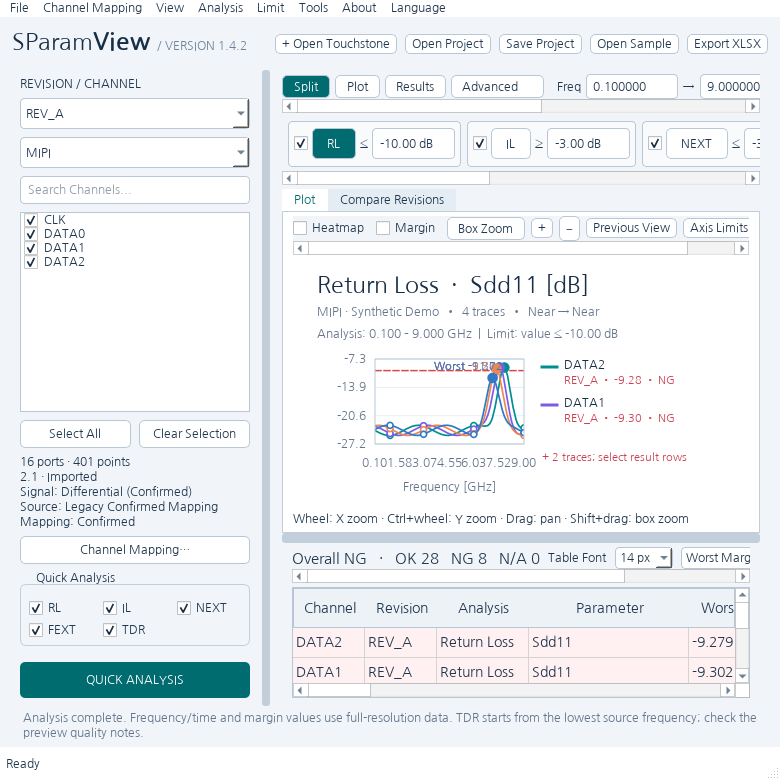
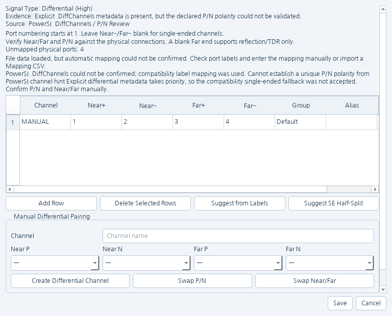
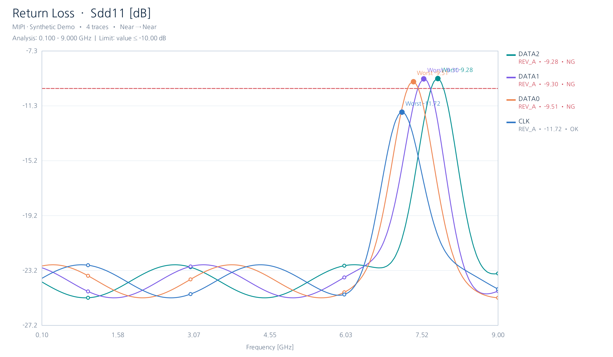
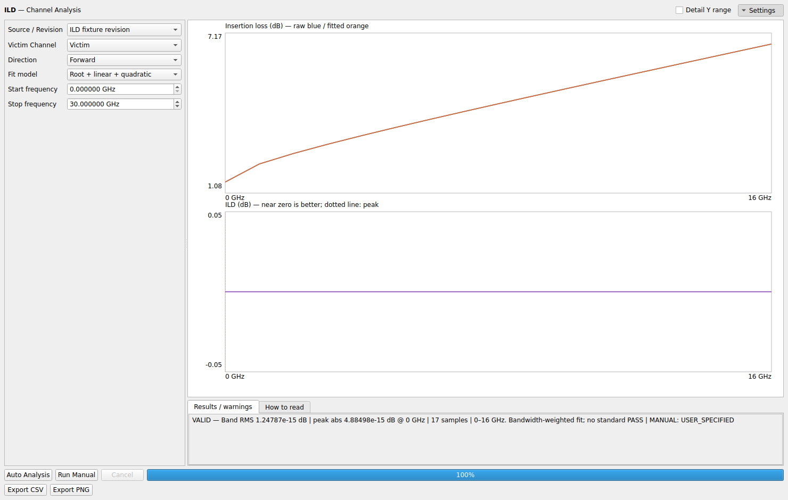
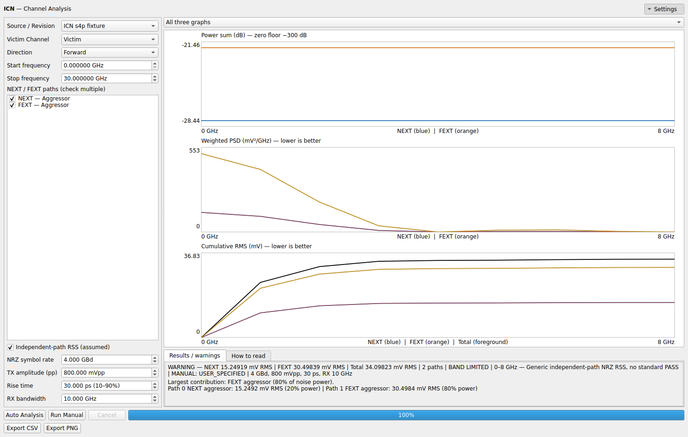
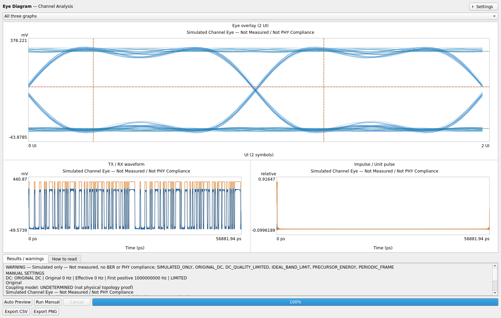

# SParamView User Guide

**Applies to:** SParamView **v1.4.2 official release**
**Supported platforms:** Windows x64 / Windows ARM64 / macOS Apple Silicon (arm64)
**Documentation updated:** 2026-11-28 (KST). Includes current screenshots, detailed operating instructions, implemented equations, examples and interpretation limits.

[한국어 사용자 설명서](USER_GUIDE_KO.md) | [English README](../README_EN.md) | [v1.4.2 Release Notes](Release_1.4.2.md) | [Documentation index](README.md)

---

## 1. Introduction

SParamView is a desktop tool for opening, analyzing, and visualizing Touchstone S-parameter data by logical channel. Its primary workflows include:

- Return Loss (RL / S11 / Sdd11)
- Insertion Loss (IL / S21 / Sdd21)
- NEXT (Near-End Crosstalk)
- FEXT (Far-End Crosstalk)
- Quick TDR
- Single-ended / Differential channel mapping
- User-defined limit evaluation with OK / NG / N/A results
- Revision comparison
- `.siproject` project save/load
- Excel, PNG, CSV, and Mapping CSV export

> **Important Notice**  
> SParamView is an **engineering reference tool** that calculates and visualizes the supplied Touchstone data. Results can differ from the actual system or measurement because of input-data quality, frequency span, port/channel mapping, interpolation or approximation, termination conditions, and other analysis settings. Independently verify important engineering decisions against the original data and trusted measurement or analysis results.

In particular, **Quick TDR is an estimate derived from a finite frequency band** and is not a substitute for an instrument TDR measurement.

### 1.1 Current analysis features

Alongside RL / IL / NEXT / FEXT / Quick TDR and Revision comparison, the Analysis menu offers independent ILD, ICN and Eye Diagram. See chapter 24 for v1.4.2 Multi View, implemented equations, examples and limitations. Earlier feature changes are retained in the appendix and [revision history](Revision_History.md).

## 2. Installation and First Launch

### 2.1 Choose the correct release package

Download the package that matches your system from GitHub Releases.

| System | Recommended package |
|---|---|
| Windows x64 | `SParamView_Windows_x64_v1.4.2.zip` |
| Windows ARM64 | `SParamView_Windows_ARM64_v1.4.2.zip` |
| macOS Apple Silicon | `SParamView_macOS_AppleSilicon_arm64_v1.4.2.dmg` or `.zip` |

SHA-256 files are also provided with the release. To verify download integrity, run `Get-FileHash <filename> -Algorithm SHA256` in Windows PowerShell or `shasum -a 256 <filename>` in macOS Terminal, then compare the result with the corresponding `.sha256` file.

### 2.2 Windows

Extract the ZIP package and run the root-level `SParamView.exe`; the command-line tool is in `tools/`. Test executables and the verification command are in the separate full QA ZIP for v1.4.0 candidates. Windows reputation or security warnings may appear. Confirm that the file came from the official GitHub release, verify the SHA-256 value, and follow your organization’s security policy before running it.

### 2.3 macOS Apple Silicon

The current public macOS package is **ad-hoc signed** and is not Apple-notarized. Gatekeeper may therefore display a warning. Verify that the package came from the official GitHub release and confirm its SHA-256 value. If you trust the package, macOS may allow it through **System Settings > Privacy & Security** according to the system’s security policy.

> Whether to override an operating-system warning is a user or organization security decision.

---

## 3. Quick Start

For a first analysis, follow this sequence:

1. Open files with **+ Open Touchstone**.
2. Review Near/Far and P/N assignments and confirm **Channel Mapping**.
3. Select the Revision and Channels.
4. Choose the required metrics and press **QUICK ANALYSIS**.
5. Review Plot and Results.
6. Adjust Limits or analysis ranges if needed, then rerun analysis.
7. Use **Save Project** or export XLSX / PNG / CSV.

The status guidance at the bottom of the main window follows the same basic sequence: `Open file → Confirm mapping → Select channels → QUICK ANALYSIS`.

---

## 4. Main Window

> **Automated validation screenshot** — The image below was generated automatically by SParamView v1.2.1 during native Windows ARM64 validation using the synthetic sample project. Layout can vary slightly with OS, DPI, and window size.
> These screenshots were generated during public v1.2.1 release validation and are **not v1.3.0 screenshots**. See section 10 for TDR display and evaluation behavior. [Image provenance](images/README.md).



### 4.1 Header shortcuts

The historical v1.2.1 screenshot shows these header shortcuts; the v1.3.2 application UI is the source of truth if placement differs:

- **+ Open Touchstone**: open one or more Touchstone files
- **Open Project**: open an SParamView `.siproject`
- **Save Project**: save the current project
- **Open Sample**: load the included sample project
- **Export XLSX**: export completed analysis results to an Excel workbook

### 4.2 Channel area

- **REVISION / CHANNEL**: select the active revision
- **All groups**: filter by channel group
- **Search Channels...**: search channel names
- **Select All / Clear Selection**: select or clear all visible channels
- **Channel Mapping...**: review or edit physical-port-to-logical-channel mapping
- **Quick Analysis**: select RL / IL / NEXT / FEXT / TDR
- **QUICK ANALYSIS**: run the selected metrics

### 4.3 Analysis and view controls

- **Split / Plot / Results**: change the workspace layout
- **Advanced**: show advanced analysis settings
- **Freq**: analysis frequency range in GHz
- **Near → Far / Far → Near / Both**: choose the displayed direction
- **Worst / Top 3 / Top 5 / Off**: automatic marker count
- **Channels / Settings / Full Screen**: show/hide panels and full-screen mode

### 4.4 Plot and Results

The Plot area displays the current analysis traces. The Results area lists channel-level worst values, locations, margins, directional deltas, status, aggressor, quality information, and units/terminations.

---

## 5. Opening Touchstone Files

Use **+ Open Touchstone** or **File > Open Touchstone...**. SParamView accepts selectable `*.s*p` and `*.ts` files and can open multiple files as revisions for comparison.

After opening a file, **always review Channel Mapping**. Successful file parsing does not guarantee that Near/Far or P/N relationships can be determined unambiguously from port labels.

SParamView reads the original Touchstone data locally and does not modify the source file.

---

## 6. Channel Mapping

The following dialog was generated automatically during a validation case where mapping could not be confirmed from the input alone. In this situation, verify the physical port relationships and confirm them manually or with a Mapping CSV.



Channel Mapping is one of the most important steps for analysis accuracy. A mathematically correct calculation can still produce the wrong engineering result if the physical ports are mapped incorrectly.

### 6.1 Basic rules

- Physical port numbering starts at **1**.
- For a single-ended channel, leave `Near−` and `Far−` blank.
- A differential channel uses a Near P/N pair.
- If the Far differential endpoint is used, both Far P and Far N must be specified.
- A channel with the Far endpoint blank can support reflection/TDR-oriented workflows.
- Always verify Near/Far and P/N against the actual physical connections.

### 6.2 Mapping columns

| Column | Meaning |
|---|---|
| Channel | Logical channel name |
| Near+ / Near− | Near-end P/N ports |
| Far+ / Far− | Far-end P/N ports |
| Group | Group used by automatic NEXT/FEXT aggressor selection |
| Alias | User alias |
| Mapping ID | Identifier used to match logical channels across revisions |

### 6.3 Editing tools

The mapping dialog supports adding/deleting rows, suggestions from port labels, a single-ended half-split suggestion, manual differential pairing, P/N swapping, and Near/Far swapping. Mapping can also be reused with **Channel Mapping > Import Mapping CSV... / Export Mapping CSV...**.

If automatic mapping is uncertain, SParamView does not silently confirm it. User confirmation is required. Changing and saving mapping invalidates existing analysis results for that revision, so the analysis must be rerun.

### 6.4 100 Ω differential vs. two 50 Ω-to-ground loads

These are different termination configurations:

- **Differential P–N 100 Ω**: 100 Ω connected between P and N
- **P–GND 50 Ω + N–GND 50 Ω**: P and N are each connected to ground through 50 Ω

SParamView keeps these conditions separate in its TDR termination options.

---

## 7. Running Analysis

### 7.1 Quick Analysis

Select the required items under **Quick Analysis**, then press **QUICK ANALYSIS**. Available metrics are:

- RL
- IL
- NEXT
- FEXT
- TDR

At least one metric and one channel must be selected, and mapping must be confirmed for all loaded revisions.

### 7.2 Individual metric analysis

The **RL / IL / NEXT / FEXT / TDR** buttons in the Settings area show the existing result when it is already valid for the current analysis context. Otherwise, SParamView recalculates that metric.

### 7.3 Direction

The direction control cycles through:

1. **Near → Far**
2. **Far → Near**
3. **Both**

For RL and IL, when both directional results are available, the Results table can show `Max ΔDir [dB]` and `Δ @ GHz`.

---

## 8. RL / IL / NEXT / FEXT Interpretation

### 8.1 Return Loss

SParamView uses RL together with **S11** for single-ended data and **Sdd11** for differential data where applicable. The current limit relation is `≤`. For example, with a `-10 dB` limit, values at or below `-10 dB` satisfy the limit.

The automatically generated validation plot below shows an **Sdd11 Return Loss** example using synthetic differential sample data. The red dashed line is the enabled limit, and the plot shows worst points together with OK/NG status.



### 8.2 Insertion Loss

IL corresponds to **S21** for single-ended data and **Sdd21** for differential data where applicable. The current limit relation is `≥`. For example, with a `-3 dB` limit, values at or above `-3 dB` satisfy the limit.

### 8.3 NEXT

NEXT represents coupling from a near-end aggressor to a near-end victim. Its limit relation is `≤`.

### 8.4 FEXT

FEXT represents coupling from a near-end aggressor to a far-end victim. Its limit relation is `≤`.

By default, NEXT/FEXT considers other channels in the **same Group** as aggressor candidates. A specific aggressor can be selected in **Advanced > Aggressor**.

---

## 9. Limits and OK / NG / N/A

Pass/fail evaluation is meaningful only when the corresponding user-defined limit is enabled.

| Analysis | Evaluation relation |
|---|---|
| RL | value ≤ Limit |
| IL | value ≥ Limit |
| NEXT | value ≤ Limit |
| FEXT | value ≤ Limit |
| TDR | Target Ω ± Tolerance % |

Result states are:

- **OK**: the enabled limit is satisfied
- **NG**: a limit violation is detected
- **N/A**: no valid pass/fail determination is available for that condition

> **N/A is not PASS.** It can appear when a limit is disabled, when a point lies outside a defined frequency-limit range, or when the required evaluation conditions are not available. If the input or computed result does not cover a requested frequency/time interval, a passing evaluated portion does not establish OK for the whole request. An observed violation keeps the verdict NG; incomplete requested coverage without an observed violation produces N/A. Read the Results notes/tooltips.

### 9.1 Frequency-dependent limits

Use **Limit > Edit Frequency Limits...** or **Advanced > Frequency Limit...** to enter `GHz, dB` points, for example:

```text
1, -10
3, -12
6, -15
```

The defined limit is not extrapolated beyond its specified frequency range; values outside that range are treated as N/A for that limit. Clear the text to return to a constant limit.

Limit settings can be saved and loaded as JSON presets.

---

## 10. Quick TDR

### 10.1 Important limitation

Quick TDR transforms finite-band Touchstone information into a time-domain engineering estimate. It is affected by factors including:

- available frequency span and frequency spacing
- availability and treatment of low-frequency/DC information
- interpolation, approximation, and windowing
- channel mapping
- reference impedance
- termination at the opposite end

Do not interpret Quick TDR as equivalent to an instrument TDR measurement.

### 10.2 Target and display scale

With `Auto Z₀`, the UI uses separate TDR views for single-ended and differential channels, nominally **50 Ω** for single-ended and **100 Ω** for differential. A target impedance can also be entered manually.

### 10.3 TDR limit

When the TDR limit checkbox is enabled, evaluation uses **Target ± Tolerance %**. For example, 100 Ω with ±10% produces an allowed range of 90–110 Ω.

### 10.4 Termination options

Use the TDR gear (⚙) button to select one or more conditions for overlay:

- **Reference**: matched to the source reference impedance
- **Resistive**: SE 50 Ω / Differential P–N 100 Ω (floating)
- **Grounded**: SE 50 Ω / Differential P–GND 50 Ω + N–GND 50 Ω
- **Open**: SE open / Differential P and N both open
- **Short**: SE–GND short / Differential P–N short (floating)

In Forward analysis the selected termination is applied at the Far end; in Reverse analysis it is applied at the Near end. Other physical ports are matched to their source reference impedances. The two single-ended 50 Ω conditions are electrically equivalent in this model and are calculated once.

Enable **Show Reflection Coefficient ρ** when reflection-coefficient display is more useful, especially for open/short comparisons. Impedance-tolerance limits do not apply to ρ.

### 10.5 Initial viewport versus analysis interval

Typical zero-based TDR results initially use an X-axis of approximately **−0.1 to 1.5 ns**. The margin before zero is display space; it does not create negative-time samples. For results that start materially away from zero, the initial view starts approximately 0.1 ns before the first computed sample and spans approximately 1.6 ns.

**The initial viewport, Zoom/Pan, and Axis Limits change the display.** To change the interval used for TDR calculation and evaluation, edit Start/Stop under **Advanced > TDR time [ns]** and rerun analysis. Stop set to **Auto** uses the available computed interval. The attainable time range remains limited by the input frequency spacing and other transform conditions.

- **Fit All**, or **Home** with the Plot focused: display the full interval of the current computed result.
- **Previous View** or **Backspace**: restore the previous viewport.
- Pressing the TDR metric button again or switching between Single-ended / Differential TDR restores the initial view.
- A manual Zoom/Pan viewport is preserved during repaint and detail refresh of the same data view.

Automatic Y scaling can prevent large termination-related impedance values from dominating the initial view. **Values outside the automatic viewport are not deleted from the calculation or evaluation.** Review Fit All and Results together when inspecting the complete computed result.

### 10.6 Quality and selected-interval suitability

`Quality` describes Quick TDR calculation conditions and is separate from the `Result` verdict OK / NG / N/A. **GOOD does not mean OK or guarantee measurement accuracy.**

| Quality | Interpretation |
|---|---|
| GOOD | The calculation path did not classify the result as limited or unsuitable. Input data and mapping still require review. |
| LIMITED | Approximation, termination, or other conditions limit interpretation. Read the Results notes/tooltips. |
| UNSUITABLE | The current input/transform conditions are unsuitable for impedance evaluation. A waveform may be unavailable or contain invalid samples. |

In v1.2.1, the uniform FFT path checks impedance singularities **inside the time interval selected in Advanced**. A singularity outside that interval alone does not make a valid selected interval unsuitable. A singularity inside the interval can still produce `UNSUITABLE` for Reference termination and the existing `LIMITED` classification for other termination views. Other input, transform, and range checks remain applicable.

For example, a synthetic regression fixture has approximately 50 Ω from 0 to 1 ns and a singularity from 5 to 6 ns. **Setting TDR time to 0–1 ns and rerunning analysis** avoids inheriting that later singularity's unsuitable classification. Merely zooming the plot to 0–1 ns does not change the analysis interval. This is a synthetic test example, not a guarantee of GOOD or OK for every real input.

---

## 11. Plot Controls

| Control | Function |
|---|---|
| Mouse Wheel | X-axis zoom |
| Ctrl + Wheel | Y-axis zoom |
| Drag | Pan |
| Shift + Drag | Box zoom |
| `+` / `−` | Zoom in/out |
| Home | Fit All |
| Backspace | Previous View |
| Axis Limits | Set X/Y ranges directly |
| Fit All | Return to the full data range |

Heatmap and Margin views are available for non-TDR plots. Moving the pointer over the plot shows the current frequency/time and displayed trace value.

---

## 12. Reading the Results Table

Important columns include:

- **Channel**: logical channel
- **Revision**: source revision
- **Analysis**: RL / IL / NEXT / FEXT / TDR
- **Parameter**: displayed S-parameter such as S11, S21, or Sdd11
- **Worst**: worst value in the analysis range
- **GHz / ns**: location of the worst value
- **Margin**: margin to the active limit
- **Max ΔDir [dB] / Δ @ GHz**: maximum RL/IL directional difference
- **Result**: OK / NG / N/A
- **Aggressor**: NEXT/FEXT aggressor
- **Quality**: calculation/preview quality information
- **Termination / Unit**: TDR termination and Ω/ρ, or dB

The summary area shows overall OK / NG / N/A counts. Rows can be ranked by **Worst Margin / Worst Value / Channel / Result**.

### 12.1 Interpreting Worst Margin ranking

Within each analysis metric, **defined margins sort first, from smallest to largest**. Missing-margin results form a separate group after them and use Worst Value severity ordering. Equal defined margins also use Worst Value severity. If both margin and severity are equivalent, the previous order is retained; this is not a guarantee of alphabetical channel order.

| Example within one metric | Margin | Worst Margin position |
|---|---|---|
| Channel C | −1 dB | 1st |
| Channel A | 0 dB | 2nd |
| Channel B | Missing | 3rd |

A missing margin does not mean ample margin. Check for a disabled limit or unavailable evaluation conditions. **Worst Value** prioritizes larger RL/NEXT/FEXT values, smaller IL values, and larger absolute deviations from Target Ω for TDR.

---

## 13. Comparing Revisions

When multiple Touchstone files are loaded as revisions, matching logical channels can be compared.

- At least two revisions are required.
- Mapping must be confirmed for every revision.
- RL/IL/NEXT/FEXT can be compared using dB differences.
- TDR comparison is performed using plot overlays rather than a dB-delta comparison table.

For a meaningful comparison, verify that the same physical signal maps to the same logical channel identity across revisions.

---

## 14. Saving and Restoring Projects

### 14.1 Save

Use the header **Save Project** button or **File > Save Project**. Use **File > Save Project As...** to choose a new file name.

A `.siproject` stores analysis settings, revision information, channel mapping, selected channels, selected UI state, and source Touchstone path/hash information.

> **Important:** A `.siproject` does not fully embed the original Touchstone data. When moving a project to another computer, keep the related Touchstone files with it.

### 14.2 Open

Use the header **Open Project** button or **File > Open Project...**. SParamView first tries the stored relative source path, then the stored absolute path. If the source file still cannot be found, it asks the user to locate the Touchstone file.

If the source Touchstone SHA-256 differs from the value stored in the project, mapping confirmation for that revision can be cleared and should be reviewed again.

---

## 15. Export

### 15.1 Excel Workbook

Use **Export XLSX** or **File > Export Excel Workbook...**. Available content options are:

- Summary
- Detailed results
- Graphs
- Raw trace data (large)

Raw trace data can significantly increase workbook size.

### 15.2 Plot PNG

Use **File > Export Plot as PNG...** to save the current plot.

### 15.3 Raw CSV

Select **exactly one row** in Results, then choose **File > Export Selected Trace as CSV...** to export the raw trace data for that result.

### 15.4 Mapping CSV

Use the Channel Mapping menu to import or export Mapping CSV files for reuse with compatible port structures.

---

## 16. Advanced Settings

Expand **Advanced** to access:

- **Marker [GHz]**: comma-separated manual frequency markers
- **Performance**: Low / Normal / Maximum
- **Aggressor**: NEXT/FEXT aggressor selection; default is `AUTO (same group)`
- **TDR time [ns]**: TDR time range
- **Peak prominence**: sensitivity-related setting for automatic peak detection
- **Frequency Limit...**: frequency-dependent limit for the current dB metric

After changing analysis settings, **rerun analysis** for the changes to affect calculated results. Export uses the settings from the last completed analysis.

---

## 17. Useful Menus

### File
Open Touchstone/Project files, save projects, and export XLSX/PNG/CSV.

### Channel Mapping
Edit/confirm mappings and import/export Mapping CSV files.

### View
Provides Split View, Maximize Plot, Maximize Results, Channel List, Analysis Settings, Full Screen, and Reset Layout. `Ctrl+1 / Ctrl+2 / Ctrl+3` switch workspace modes, and `F11` toggles full screen.

### Limit
Save/load limit presets and edit frequency-dependent limits.

### Tools
- **Open Sample Project**
- **Verify Source SHA-256**: verify that the current Touchstone source still matches the source hash used for analysis

---

## 18. Troubleshooting

| Symptom | Check |
|---|---|
| Touchstone opens but analysis cannot run | Confirm Channel Mapping |
| Mapping is not automatically confirmed | Port labels may be ambiguous; use manual mapping or Mapping CSV |
| QUICK ANALYSIS does not run | Select at least one channel and one analysis metric |
| No NEXT/FEXT result | Check for a valid same-group aggressor and valid Near/Far mapping |
| Result is N/A | Check whether the limit is enabled, whether the point is inside the frequency-limit range, and whether evaluation conditions exist |
| Settings changed but results did not | Rerun analysis after changing settings |
| Later TDR times are absent from the initial view | Use **Fit All**; to change the analysis interval, edit **TDR time [ns]** and rerun |
| Apparently normal TDR interval is N/A | Check Quality, Limit, selected interval, and attainable range; zooming alone does not change analysis coverage |
| Missing-margin rows appear later | Expected v1.2.1 Worst Margin ordering; missing margin is separate from an OK verdict |
| TDR differs greatly from expectation | Review frequency span/spacing, mapping, target Z₀, termination, and source-data quality |
| Project cannot find its source file | Relocate the Touchstone file; reconfirm mapping if the file changed |
| CSV export fails | Select exactly one Results row |
| XLSX export fails | Complete an analysis first |
| macOS launch warning appears | Verify official release/SHA-256 and follow macOS Privacy & Security policy |

For a reproducible issue report, record the SParamView version, OS/architecture, Touchstone port count, exact reproduction steps, and any error message.

---

## 19. Sample Data

The repository `examples/` directory contains synthetic demonstration fixtures for UI and regression testing. They are not real product measurement data. Use **Open Sample** or **Tools > Open Sample Project** to explore the basic workflow.

---

## 20. Data and Privacy

SParamView performs analysis locally and treats the original Touchstone source as read-only. Project and export files are written to user-selected local paths.

---

## 21. Support and License

SParamView source is distributed under the MIT License. Third-party components and fonts retain their respective licenses. See `LICENSE`, `COPYRIGHT.txt`, and `third_party/` in the repository for details.

Contact: **sparamview@gmail.com**

---

## 22. Documentation verification sources

Historical v1.2.1 feature changes are supported by the [v1.2.1 release notes](Release_1.2.1.md) and the source links below. For the current release, see the [v1.4.2 release notes](Release_1.4.2.md), [temporary-cache policy](Temporary_Cache_Cleanup.md), [revision history](Revision_History.md), and [tagged source](https://github.com/july-rust/SParamView-Public/tree/v1.4.2). Previous v1.2.4a validation is retained in the [historical release notes](Release_1.2.4a.md).

- [Initial TDR axes and automatic scaling](https://github.com/july-rust/SParamView-Public/blob/v1.2.1/src/plot.cpp)
- [Plot interaction and viewport restoration](https://github.com/july-rust/SParamView-Public/blob/v1.2.1/src/navigation.cpp)
- [Selected-interval TDR suitability](https://github.com/july-rust/SParamView-Public/blob/v1.2.1/src/tdr.cpp)
- [Result ranking](https://github.com/july-rust/SParamView-Public/blob/v1.2.1/src/jobs.cpp)
- [Requested coverage and OK/NG/N/A evaluation](https://github.com/july-rust/SParamView-Public/blob/v1.2.1/src/analysis.cpp)
- [Ranking and TDR interval regression tests](https://github.com/july-rust/SParamView-Public/blob/v1.2.1/tests/v121_regression_tests.cpp)

---

### Document Version

This guide applies to v1.4.2 (2026-11-28 KST); screenshots are sourced from v1.4.2 release evidence and the documented GUI capture run.


## 23. What's new in v1.4.0

- Independent ILD, Generic ICN and simulated NRZ Eye Diagram analysis windows. Select the mapped victim/path; use Auto Analysis/Auto Preview for initial conditions or Run Manual for known conditions. Review assumptions, warnings, and quality status; export CSV/PNG.
- ILD displays measured/fitted insertion loss and deviation. ICN integrates mapped NEXT/FEXT paths with explicit signal/filter and independent-path RSS assumptions. Eye Diagram is a band-limited simulation, not measured BER. Auto settings are engineering assumptions, not inferred PHY settings.
- Eye Diagram checks DC quality. For missing DC, start frequency up to 10 kHz has no frequency-based confirmation, above 10 kHz and below 100 kHz requires confirmation, and at or above 100 kHz is blocked; other quality checks still apply. Conditional AC-like one-pole extrapolation does not establish physical topology or long-pattern accuracy.
- Runtime English/Korean/Japanese language switching; Language menu stays in English. New resets the workspace after unsaved-change confirmation; multiple Touchstone files are processed sequentially with individual mapping. Last directory and main-window state are remembered. Analysis windows adapt to the display; guidance scrolls independently of plots. Table refresh, overlay and rendering are optimized.
- Default limits: RL -10 dB, IL -3 dB, NEXT/FEXT -20 dB, TDR -10%; checks initially off. These are configurable examples, not standards.
- Windows user ZIP excludes optional test executables and verification launcher; separate QA ZIP supports validation.

**Scope:** engineering-reference calculations only. COM is deferred and has no production menu. No IEEE/SNIA/MIPI compliance, measured BER or exhaustive physical-platform/HiDPI certification is claimed.

[Release notes](Release_1.4.2.md) · [ILD](Channel_Analysis_ILD_012_05.md) · [ICN](Channel_Analysis_ICN_012_06.md) · [Eye Diagram](Channel_Analysis_Eye_012_07.md) · [AC/Auto](qualification/012_54_AC_Auto_Analysis.md).


## v1.4.2 — Eye Diagram Multi View

Eye Diagram now offers **All three graphs** alongside the existing individual views: Eye overlay (2 UI), TX / RX waveform and Impulse / Unit pulse. All panels share one accepted numerical result, use independent axes and interaction, and support PNG export of the selected view. The combined layout adapts to logical width; narrow windows can scroll. The existing simulation-only qualification limits remain unchanged.

## v1.4.1 — Window and workspace behavior

- **v1.4.1:** File > New closes ILD, ICN and Eye Diagram only after confirmation; Cancel or a failed save preserves the workspace. File > Exit uses the normal save/cleanup path. Window geometry is fitted to the active monitor's logical work area, with scrollable custom dialog bodies and fixed confirmation buttons. Qt file dialogs are used consistently across platforms.
High-DPI displays use logical rather than physical pixels; very small work areas can still be limited by platform/widget minimum sizes. The geometry policy does not claim physical certification of every screen and scaling combination.

## 24. Numerical reference and analysis workflow (v1.4.2)

This chapter explains the equations actually implemented in the released C++ reference engine, not a proposed future feature or an IEEE compliance procedure. All worked examples are illustrative calculations, not measured values or results extracted from the screenshots. The screenshots use synthetic QA fixtures; see [capture provenance](images/README.md). Code references point to the immutable v1.4.2 tag. SI units are used internally (Hz, s, V, Ω); the GUI converts to GHz, ns/ps, mV and dB where appropriate.

### 24.1 From Touchstone to a physical channel

1. Open an SNP file (Touchstone 1.0/1.1/2.0/2.1 S-parameter data). Verify frequency range, reference impedance, port labels and orientation. RI, MA and DB data represent the same complex number: $S=x+jy$, $S=M e^{j\theta}$, or $S=10^{D/20}e^{j\theta}$, with phase in radians for the exponential (Touchstone angles are degrees).
2. Confirm the Single-ended or Differential mapping for each Revision. For Differential, check near P/N and far P/N polarity. Do not infer a physical pair merely from a similar net name. Reversed or swapped endpoints change the selected transfer function and may change its phase.
3. Select the victim, aggressor where required, direction, and frequency or time range. Run Quick Analysis or an individual metric. Use the separate Analysis menu for ILD, ICN and Eye Diagram.
4. Inspect Status, Quality, the worst point and the full curve before exporting. Compare Revisions with consistent mapping, direction, termination, reference and limits. A missing result is not a pass.

For compatible equal-reference physical pairs, the differential incident and reflected power waves are defined by the unit vector $u=(1,-1)^T/\sqrt{2}$. The channel transfer is

$$S_{dd}=u_r^T S_{\mathrm{physical}}u_s=\tfrac12(S_{r_p s_p}-S_{r_p s_n}-S_{r_n s_p}+S_{r_n s_n}).$$

Here $r$ is the response endpoint and $s$ the stimulus endpoint; the matrix index order is response, stimulus. For a single-ended endpoint, its vector has weight 1. This is the implemented projection, not arbitrary renormalization of unequal references. Equal 50 Ω physical ports correspond to 100 Ω differential reference; compare like references. The Quick metrics do not evaluate SE-to-differential cross-mode coupling.

Complex interpolation between two measured samples uses $S(f)=(1-a)S_i+aS_{i+1}$, $a=(f-f_i)/(f_{i+1}-f_i)$. It is not interpolation of dB alone. An analysis cap beyond measured coverage does not create new measured data.

Implementation: [trace and direction](https://github.com/july-rust/SParamView-Public/blob/v1.4.2/src/trace.cpp), [endpoint and load mapping](https://github.com/july-rust/SParamView-Public/blob/v1.4.2/src/termination.cpp), [Touchstone 2.1 specification](https://ibis.org/touchstone_ver2.1/touchstone_ver2_1.pdf).

### 24.2 Return Loss, Insertion Loss, NEXT and FEXT

All four Quick frequency metrics plot $D(f)=20\log_{10}|H(f)|$ dB, where $H$ is the selected complex S-parameter. Zero magnitude corresponds to negative infinity. Conventional positive return loss or positive insertion loss is $-D$; this program's Quick plots use **signed S-parameter dB**, not the positive loss convention.

| Metric | Forward path (Near to Far) | Reverse path | Better direction in signed dB |
|---|---|---|---|
| RL | Victim Near reflection: S11/Sdd11 | Victim Far reflection: S22/Sdd22 | More negative |
| IL | Victim Far response to Near drive: S21/Sdd21 | S12/Sdd12 | Closer to 0 dB for a passive through path |
| NEXT | Victim Near response to aggressor Near drive | Victim Far response to aggressor Far drive | More negative |
| FEXT | Victim Far response to aggressor Near drive | Victim Near response to aggressor Far drive | More negative |

For example, $|S_{11}|=0.1$ gives -20 dB (positive return loss 20 dB) and reflected power fraction $|S_{11}|^2=1\%$. $|S_{21}|=0.5$ gives approximately -6.02 dB, transmitted power fraction 25% for compatible power-wave reference conditions. A coupling magnitude of 0.01 corresponds to -40 dB and power fraction 0.01%. These are wave ratios, not necessarily delivered voltage or dissipated power in a mismatched circuit.

For **Both** direction, RL/IL directional delta is $\max_f|D_{\rm forward}(f)-D_{\rm reverse}(f)|$ over the common frequency interval, with complex interpolation on the union of frequency bins. A large delta can reveal asymmetry or mapping issues; it is not a standalone compliance criterion. Equal transmission in a reciprocal network is expected for compatible port normalization, but reflection at the two ends need not be equal.

Implementation: [trace.cpp](https://github.com/july-rust/SParamView-Public/blob/v1.4.2/src/trace.cpp).

### 24.3 Limit, worst margin and interpretation

Enable the desired limit explicitly. The initial editable examples are RL -10 dB, IL -3 dB, NEXT/FEXT -20 dB, and TDR 10% tolerance; limit checkboxes start disabled. They are not universal interface specifications.

For a signed dB limit $L(f)$ and calculated trace $D(f)$:

$$m(f)=\begin{cases}D(f)-L(f),&\text{IL}\\ L(f)-D(f),&\text{RL, NEXT, FEXT}\end{cases}$$

The displayed worst margin is the minimum evaluated margin. Piecewise-linear frequency limits are interpolated in their given dB values; no limit extrapolation is allowed outside the defined interval. For TDR, $m(t)=Z_{\rm target}p/100-|Z(t)-Z_{\rm target}|$ in Ω, where $p$ is the tolerance percentage.

Example: RL -14 dB with limit -10 dB has +4 dB margin. IL -4 dB with limit -3 dB has -1 dB margin. TDR target 100 Ω and tolerance 10% gives the 90–110 Ω range; a point at 112 Ω has -2 Ω margin. A detected violation is NG even if other samples are unknown; otherwise incomplete coverage, unknown samples or unsuitable results are N/A, not OK. OK only means the enabled engineering limit was evaluated and satisfied.

Implementation: [analysis.cpp](https://github.com/july-rust/SParamView-Public/blob/v1.4.2/src/analysis.cpp), [limit interpolation](https://github.com/july-rust/SParamView-Public/blob/v1.4.2/src/termination.cpp).

### 24.4 Quick TDR: from reflection to impedance

Select TDR, choose the reference or opposite-end load, set the target impedance and the actual analysis interval (not merely the zoomed display), and review Quality before using the impedance trace. Reference termination leaves the source S-parameters' other physical ports matched to their references. Other loads are applied to the mapped opposite end.

For a real reference impedance $Z_0$ and calculated real step reflection $\rho(t)$:

$$Z(t)=Z_0\frac{1+\rho(t)}{1-\rho(t)}.$$

Example: at 100 Ω reference, $\rho=+0.1$ gives 122.22 Ω; $\rho=-0.1$ gives 81.82 Ω. A positive reflected step raises the inferred impedance; a negative step lowers it. A near-open singularity is not a usable finite impedance point.

The default transform uses a uniform positive-frequency grid, Kaiser taper $W(u)=I_0(\beta\sqrt{1-u^2})/I_0(\beta)$, $u=f/f_{\max}$, Hermitian negative-frequency reconstruction, IFFT and a shifted cumulative trapezoidal sum of the impulse. Here $I_0$ is the modified Bessel function and $\beta$ controls tapering. The time sample spacing is $\Delta t=1/(2f_{\max})$, and the transform's periodic interval is $1/\Delta f$. The selected nonnegative analysis range is capped at $0.45/\Delta f$. Sample spacing is not guaranteed spatial or instrument resolution. If DC is absent, the code linearly extrapolates the first two real reflection samples to DC and forces a real DC value. The routine marks extrapolation/resampling limitations and rejects unreasonable DC or a low-frequency gap exceeding 10% of the upper frequency.

If uniform-grid reconstruction error exceeds the documented preview threshold of 0.05 in absolute complex S, the implementation uses a nonuniform step integral over original intervals:

$$\rho(t)=\frac{\Re S(0)}{2}+\int_0^{f_{\max}}\frac{W(f)[\Re S(f)\sin(2\pi ft)+\Im S(f)\cos(2\pi ft)]}{\pi f}\,df.$$

It compares quadrature orders and interpolation sensitivity; failure is reported rather than silently interpreted as a valid result. These are numerical preview heuristics, not calibrated instrument specifications. More bandwidth generally helps resolve short features; missing DC, sparse grids, noise and tapering affect the response. To estimate distance for a known uniform propagation velocity $v_p$, use $d=v_p t/2$ (round-trip delay); this is an engineering conversion, not an automatically measured dielectric constant or distance feature of SParamView.

For a non-reference opposite-end load, the code partitions the physical scattering response into driven and loaded subblocks. With incident load wave $a_L=\Gamma_L b_L$ it solves $(I-\Gamma_L S_{LL})a_L=\Gamma_L S_{LN}a_N$ and evaluates $b_N=S_{NN}a_N+S_{NL}a_L$. In the nonsingular case the effective reflection is

$$S_{\rm eff}=S_{NN}+S_{NL}(I-\Gamma_L S_{LL})^{-1}\Gamma_L S_{LN}.$$

For a single resistive port $\Gamma_L=(R-Z_0)/(R+Z_0)$. Open and short give +1 and -1 respectively. A floating differential P–N 100 Ω load and two 50 Ω-to-ground loads have different common-mode boundaries; the code solves the physical load feedback rather than substituting identical scalar terminations. Nonunique or inconsistent solutions fail closed.

Implementation: [tdr.cpp](https://github.com/july-rust/SParamView-Public/blob/v1.4.2/src/tdr.cpp), [termination.cpp](https://github.com/july-rust/SParamView-Public/blob/v1.4.2/src/termination.cpp).

### 24.5 ILD — Insertion Loss Deviation

Open **Analysis → ILD**, select the verified source, victim and direction, and use Auto Analysis for the measured fit band or Run Manual to set the band and model. The graph shows positive loss and fitted loss, then their signed deviation. Inspect the actual fitted band, RMS, peak absolute deviation and its frequency. Smaller residuals are preferable for a comparable fit band/model, but do not guarantee low total insertion loss.



Unlike the Quick IL plot, the ILD engine uses positive loss $A(f)=-20\log_{10}|H(f)|$. Set $x=f/F$, where $F$ is the last included measured frequency. Available models are:

$$\widehat A=a_0+a_1x,\qquad \widehat A=a_0+a_1\sqrt{x}+a_2x,\qquad \widehat A=a_0+a_1\sqrt{x}+a_2x+a_3x^2.$$

The root-linear model is the default. These flexible smooth curves are engineering fitting bases; the coefficients are not direct dielectric or copper material measurements. The fit minimizes $\sum_i w_i[A_i-\widehat A_i]^2$ with normalized trapezoidal cell weights $w_i=(\Delta f_{\rm left}+\Delta f_{\rm right})/(2B)$, where $B=f_{\rm last}-f_{\rm first}$, and missing endpoint intervals are zero. A twice-reorthogonalized modified Gram–Schmidt QR solve avoids direct inversion of normal equations.

Residual $e_i=A_i-\widehat A_i$; peak deviation is $\max_i|e_i|$. The reported RMS uses the exact integral of the squared piecewise-linear residual:

$$e_{\rm RMS}=\sqrt{\frac1B\sum_i\frac{f_{i+1}-f_i}{3}(e_i^2+e_ie_{i+1}+e_{i+1}^2)}.$$

Example: a +0.5 dB residual means measured positive loss is 0.5 dB higher than the fitted loss; a -0.5 dB residual means it is lower. A residual changing linearly from -1 to +1 dB over one interval has interval RMS $1/\sqrt3\approx0.577$ dB, not 1 dB. The implementation uses only measured bins within the selected band and rejects zero transfer or insufficient/rank-deficient fits. Automatic ILD may raise the start to at least ten times an observed AC-like pole frequency. It does not extrapolate missing loss data. Compare with the same model and frequency band; this is generic ILD, not IEEE weighted FOM_ILD.

Implementation: [ild.cpp](https://github.com/july-rust/SParamView-Public/blob/v1.4.2/src/channel_analysis/ild.cpp), [ILD numerical contract](Channel_Analysis_ILD_012_05.md).

### 24.6 ICN — Integrated Crosstalk Noise

Open **Analysis → ICN**, choose the mapped victim, direction and distinct NEXT/FEXT aggressor paths (1–32). Auto Analysis uses exploratory assumptions; use Run Manual for known baud, TX Vpp, 10–90% rise time, receiver bandwidth and integration band. Multiple paths require the independent/RSS assumption to be enabled. Select **All three graphs** to compare power sum, weighted noise PSD and cumulative RMS; cumulative RMS including total is the initial view.



For equiprobable independent zero-mean NRZ symbols, let $T=1/R_s$, $\sigma_V=V_{pp}/2$, $\sigma_t=t_{10-90}/2.5631031310892007$, and $\operatorname{sinc}(x)=\sin(x)/x$. The implemented one-sided weighted PSD in V²/Hz is

$$P(f)=2\sigma_V^2 T\operatorname{sinc}^2(\pi fT)\exp[-(2\pi f\sigma_t)^2]\frac1{1+(f/f_{\rm RX})^2}.$$

For each measured path $H_k(f)$, its weighted output PSD is $P_k(f)=|H_k(f)|^2P(f)$. The unweighted power-sum graph uses $10\log_{10}\sum_k|H_k|^2$; the -300 dB floor applies only to display. The PSD graph uses mV²/GHz ($1$ V²/Hz = $10^{15}$ mV²/GHz). Cumulative noise power uses the trapezoidal integral over the measured overlap:

$$V_k(f_j)=\sqrt{\sum_{i<j}\tfrac12[P_k(f_i)+P_k(f_{i+1})](f_{i+1}-f_i)},\quad V_{\rm total}=\sqrt{V_{\rm NEXT}^2+V_{\rm FEXT}^2}.$$

Contribution percent is $100(V_k/V_{\rm total})^2$ when total is nonzero. Example: independent NEXT 3 mV RMS and FEXT 4 mV RMS give 5 mV total, not 7 mV. Contributions are 36% and 64%. Correlated aggressors cannot generally be combined this way.

Auto settings: cap = min(10 GHz, measured maximum); symbol rate = min(4.5 GBd, cap/1.5); TX 400 mVpp, rise time 30 ps, RX bandwidth = cap. These are assumptions, not values inferred from the actual transmitter. The integral is restricted to the measured band; missing DC/out-of-band noise is not extrapolated. Unequal references or mismatched grids are rejected. A lower result is generally preferable under identical assumptions, but no universal ICN pass limit or IEEE/SNIA compliance is asserted.

Implementation: [icn.cpp](https://github.com/july-rust/SParamView-Public/blob/v1.4.2/src/channel_analysis/icn.cpp), [ICN technical contract](Channel_Analysis_ICN_012_06.md).

### 24.7 Eye Diagram — simulated NRZ waveform

Open **Analysis → Eye Diagram**. Confirm source mapping and direction. Use Auto Preview as a first engineering check or set actual electrical parameters, profile, bit rate, frequency cap, pattern, FFT length and samples/UI in the Manual settings tabs before Run Manual. Review the assumption banner, DC status, input linear range, Eye Height/Width and warnings. The three graph modes are:

- **Eye overlay (2 UI):** phase-aligned RX waveform segments; dashed threshold and high/low envelope or sampling markers when available. Larger separation and longer valid phase interval are generally desirable for identical settings.
- **TX / RX waveform:** inspect amplitude, delayed transitions, ringing and intersymbol interference (ISI) relative to the transmitted sequence.
- **Impulse / Unit pulse:** normalized channel impulse and response to a one-UI unit-height pulse; tails illustrate how previous symbols can influence later symbols.
- **All three graphs:** the above plots use a single immutable numerical result; no recalculation on selection. Wide logical layouts place auxiliary panels side by side and narrow layouts stack them. Scroll if necessary; zoom and pan are independent. Mouse wheel zoom, drag pan, and double click reset. Export PNG captures the selected view (including combined view); CSV preserves original numerical samples.



For NRZ bit rate $R_b$, samples/UI $M$, and FFT length $N$:

$$UI=1/R_b,\quad f_{\rm ref}=R_b/2,\quad f_s=MR_b,\quad \Delta t=1/f_s,\quad \Delta f=f_s/N.$$

The selected analysis cap is independent of $f_{\rm ref}$ and must be supported by measured data and sampling Nyquist. The engine uses complex linear interpolation, qualified DC conditioning, a Hermitian spectrum and zero above the cap (an ideal band-limited **simulation assumption**, not measured transfer). With $H[k]$ the constructed complex transfer,

$$h[n]=\operatorname{IFFT}\{H[k]\},\quad y[n]=\Re\{\operatorname{IFFT}(\operatorname{FFT}(x[n])H[k])\}.$$

The input $x$ repeats a finite deterministic NRZ frame of $N/M$ bits. The unit pulse is 1 for the first $M$ samples and 0 thereafter, passed through the same transfer. The delay index $d$ is the largest impulse-energy sample; estimated delay is $d\Delta t$. Unresolved/circular delay or invalid input blocks the result. This is a periodic convolution, not a long random data stream or measured jitter distribution.

For each sampled phase $p=0,\ldots,M-1$, define $H_{\min}(p)=\min_{b_i=1}y[(iM+d+p)\bmod N]$ and $L_{\max}(p)=\max_{b_i=0}y[(iM+d+p)\bmod N]$. The implemented metrics are

$$\text{Eye Height}=\max_p[H_{\min}(p)-L_{\max}(p)],$$

$$O(p)=[H_{\min}(p)>V_{\rm th}\ \text{and}\ L_{\max}(p)<V_{\rm th}],\qquad
\text{Eye Width}_{UI}=\frac{\text{longest circular run of true }O(p)}{M}.$$

Eye Width in seconds is Eye Width in UI multiplied by UI. The maximum-height phase need not satisfy the specified threshold; the program warns separately. Overlay renders up to 64 segments, whereas the metrics use the full finite simulated frame. Width is a sampled-time estimate, not interpolated BER contours.

Worked example: 4.5 Gbps gives UI 222.22 ps and reference 2.25 GHz. With $M=32$ and $N=8192$, sample spacing is 6.944 ps, sample rate 144 GHz, bin spacing 17.578125 MHz and frame length 256 bits (56.889 ns). If a hypothetical valid phase has minimum high +120 mV and maximum low -80 mV, separation is 200 mV. If the longest run of open phases at threshold zero is 24 samples, width is 0.75 UI (166.67 ps). These are examples, not guaranteed channel results.

Auto Preview assumes PRBS7, TX -200/+200 mV (400 mVpp incident wave), matched equal real reference impedances, threshold 0 mV, RX linear range -1000/+1000 mV; cap and bit rate follow min(10 GHz, measured maximum) and min(4.5 Gbps, cap/1.5). Manual mode needs explicit low/high voltages, matched TX/RX reference and RX linear range/threshold. Unequal references are not renormalized by this engine. MIPI D-PHY HS profile is differential and limited to 4.5 Gbps; profiles are not PHY conformance tests.

Implementation: [eye.cpp](https://github.com/july-rust/SParamView-Public/blob/v1.4.2/src/channel_analysis/eye.cpp), [Eye plot and export](https://github.com/july-rust/SParamView-Public/blob/v1.4.2/src/gui/analysis/analysis_windows.cpp).

### 24.8 DC extrapolation and AC coupling in Eye Diagram

For a source missing DC, the implemented frequency policy is:

| Original start frequency | Handling |
|---|---|
| up to and including 10 kHz | No frequency-based confirmation; local checks still apply |
| greater than 10 kHz and below 100 kHz | Explicit acknowledgement of limited extrapolation required |
| 100 kHz or greater | Block the simulation |

A supplied 0 Hz point is not automatically trustworthy: DC consistency and local coverage are checked, with sparse DC cases treated separately. A qualified local even-real fit and alternate/constant comparisons condition DC; a supported observed AC-like pole may instead use $H_{\rm RC}(f)=G(jf/f_p)/(1+jf/f_p)$ anchored to the first measured point. The code retains measured complex samples. This fit is not proof of a coupling-capacitor topology.

For the ideal fitted pole, $\tau=1/(2\pi f_p)$ and the fractional decay of a step over duration $t$ is $1-e^{-t/\tau}$. For a run of $n$ bits, use $t=n\,UI$. The separately reported long-step model checks two numerical grids; it does not establish physical long-pattern baseline wander. An open short-frame eye is therefore not sufficient to accept an AC-coupled link. A source starting at 1 kHz is eligible for the first policy band, but eligibility is not an accuracy guarantee.

Implementation: [DC and long-run model in eye.cpp](https://github.com/july-rust/SParamView-Public/blob/v1.4.2/src/channel_analysis/eye.cpp), [DC qualification](qualification/012_52_Eye_DC_Qualification.md), [AC/Auto qualification](qualification/012_54_AC_Auto_Analysis.md).

### 24.9 Engineering checklist and validation boundary

- Use the same source, reference, mapping, direction, bands, fit, TX/RX and limits when comparing results. Correct phase and reference data are essential for time-domain analysis.
- A larger eye, smaller residual ILD or smaller integrated ICN is only meaningful under comparable assumptions. Check absolute IL, RL and TDR as well. Do not use any generic metric as a substitute for a protocol's mask, receiver model, calibrated BER, or standard-specific compliance.
- Export full numerical CSV or Excel where supported and keep source hashes/settings with the report. PNG is a visual record, not full numerical evidence. Source/mapping changes invalidate dependent analysis results.
- COM research is retained but production COM is deferred and not exposed. Do not infer COM from ILD, ICN or Eye metrics.
- The tagged v1.4.2 passed the [three-platform release CI](https://github.com/july-rust/SParamView-Public/actions/runs/46093773220) and [CodeQL](https://github.com/july-rust/SParamView-Public/actions/runs/46093773213). These automated tests do not certify every physical DPI/monitor, actual board, long-pattern accuracy or instrument equivalence.

## Appendix A. Historical version changes

### Changes relevant to v1.2.1 users

| Area | User-visible behavior |
|---|---|
| Input validation | Invalid numbers, ranges, and ambiguous input conditions are rejected safely. Review the input and settings when an error appears. |
| Initial TDR view | Typical zero-based results initially show approximately −0.1 to 1.5 ns. Use **Fit All** to inspect the full computed interval. |
| Selected TDR interval | The uniform FFT path no longer marks an otherwise valid selected interval `UNSUITABLE` solely because an impedance singularity exists outside it. |
| Worst Margin ranking | Within each analysis metric, results with defined margins appear first; missing-margin results form a separate group. |

The v1.2.0 source partitioning is an internal code-structure change and requires no extra user configuration. For the intervening changes, see [v1.1.6](Release_1.1.6.md), [v1.1.7](Release_1.1.7.md), [v1.2.0](Release_1.2.0.md), and [v1.2.1](Release_1.2.1.md).

---

### v1.2.4a workflow changes

- Review **Signal Type Detection** before Channel Mapping when prompted. A Single-ended choice disables name-based P/N inference, including **Suggest from Labels**. Explicit `.DiffChannels` and Mixed-Mode descriptors remain separate evidence. Confirm Near/Far manually where required; the dialog identifies unmapped ports.
- Analysis buttons calculate the current selected channels, filters and Aggressor. Identical completed requests can be reused. The Metric selector only changes the displayed results; it does not execute a new request. Direction buttons select views of calculated directions.
- Opening a project fully verifies the current source SHA-256. Changed sources discard old confirmed mappings and require review of newly generated candidates. Valid source data remains available for manual recovery.
- Saved controls, marker settings, selected channels, search and Aggressor participate in unsaved-change tracking. Switching projects offers Save / Discard / Cancel; cancelled or failed saves retain the current project.
- Excel Configuration includes signal type, confidence/evidence, mapping source/confirmation, source SHA-256 and verification, analysis completion time, report generation time and the actual analysis settings snapshot. Settings changed after analysis are not relabeled as the settings used for those results.
- Additional Touchstone option lines are ignored with a diagnostic; the first option line remains authoritative. Symmetric Lower/Upper mixed-mode matrices are supported.
- The retained screenshots below were captured with v1.2.1 test fixtures; they are **not** screenshots from v1.2.4a. The compact settings strip introduced in v1.2.2 remains 74 px.

**Post-release validation (2026-10-13):** The published v1.2.4a binaries are unchanged. CI/test updates use GCC for the Release core and Clang for ASan/UBSan, native Cocoa for macOS GUI validation, and GitHub CLI for artifact retrieval. The official [main validation](https://github.com/july-rust/SParamView-Public/actions/runs/38383938009) reported no compiler, Qt test-platform, or artifact-download warning messages; all ten native Windows ARM64 fallback mapping checks passed. These are test-infrastructure and documentation updates, not new application features.

### v1.2.5 automatic cleanup on exit

- Each GUI process creates a private cache directory holding imported `.sicache`, in-progress `.sicache.tmp`, and Excel report staging files. On normal exit, it waits for workers to finish, closes cache handles, and removes its own directory.
- Other active GUI instances are protected by lock leases. A subsequent launch reclaims only abandoned SParamView-owned session directories verified by ownership markers and locks.
- CLI commands without an explicit cache path clean their command-private cache at exit. An explicitly supplied CLI cache directory remains user-managed.
- Original Touchstone files, saved `.siproject` projects, exported XLSX/CSV/PNG reports, mapping presets, and application/UI settings are preserved. **Unleased shared caches from earlier releases are not removed** to avoid disrupting older running applications.
- Reopening a source after exit entails a new import and may increase first-load time.

See [Temporary Cache Cleanup](Temporary_Cache_Cleanup.md) and [v1.2.5 Release Notes](Release_1.2.5.md).

### v1.3.5 Mapping CSV and GUI/cache safety

- Mapping CSV v3 (`v3-text-percent`) prefixes all four text columns with `text:` and percent-encodes whitespace, controls and `%`. Examples: `00123` → `text:00123`, newline → `%0A`, literal `%` → `%25`. Port columns remain integers. Preserve the prefix and escapes when editing CSV directly; prefer the Channel Mapping editor. Legacy v1/v2 files remain readable, but **v1.3.4 cannot read new v3 files**. See [qualification scope](Final_Qualification_1.3.5.md) for actual Linux Calc GUI evidence and Excel/platform limitations.
- GUI startup errors are reported interactively, or exit nonzero for headless/automated launches; failed cache session construction cleans only owned temporary resources.
- Electrical calculations and project schema remain unchanged. See [v1.3.5 release notes](Release_1.3.5.md), [Stage 2 validation](V133_Stage2_CSV_Validation.md), and [Stage 3 validation](V133_Stage3_Startup_Validation.md).

### v1.3.3 Touchstone port parsing safety

- PowerSI `.DiffChannels` indices are zero-based unsigned decimal integers; fractional, signed, overflowing or out-of-range entries are not confirmed. The tool reports mapping diagnostics and preserves manual review options.
- Mixed-Mode `S<n>`, `D<n>,<n>`, and `C<n>,<n>` port descriptors are checked as complete positive integer tokens and must be in the declared physical port range.
- Legacy `! Port N = NAME`, scoped `! PortN_COMPONENT_PIN::NET`, and near/far/P/N suffix labels use bounded linear parsing to avoid recursive regular-expression behavior on large labels. UTF-8 label bytes are preserved.
- No cache storage, project schema, numerical RL/IL/NEXT/FEXT/TDR, or multi-process isolation behavior changes are intended. See [v1.3.3 release notes](Release_1.3.3.md).

### v1.3.2 project cache switching and active Touchstone filename

- **Open Project** validates source paths and SHA-256, stages a new project cache, then replaces the workspace only on successful import. An invalid project, cancelled source relocation or failed import leaves the existing workspace intact. Save/Discard/Cancel protection for unsaved changes remains in place.
- A successful project replacement clears earlier computed analysis jobs, comparison rows, non-TDR and TDR plot axes/zoom/navigation history, selected channel UI and retired project cache files after closing dependent worker handles. Other simultaneous SParamView processes are not affected.
- **+ Open Touchstone** (one file or multiple files) still **appends revisions** to the current workspace for comparisons; it does not replace the current project.
- The window title includes the **currently selected source Touchstone filename, including its extension**. Changing the Revision selector changes the title. Hovering over Revision reveals the complete source path. Extremely long titles may still be visually clipped by operating-system window decorations.
- New schema-1 `.siproject` files omit the obsolete ephemeral `cache` path; existing schema-1 projects with the field are still accepted. The full source SHA-256 verification is preserved.
- See [v1.3.2 release notes](Release_1.3.2.md), [Issue #15](https://github.com/july-rust/SParamView-Public/issues/15) and the [cache policy](Temporary_Cache_Cleanup.md).

### v1.3.1 concurrent-instance cache safety

- Each running SParamView application process owns its own `session-XXXXXX` cache directory, even when two windows import the *same* Touchstone file. Ending one process removes only its private cache and does not remove active caches belonging to other processes.
- Registry locking now covers both session startup/recovery and normal shutdown removal. If a cache directory is temporarily locked, deletion is deferred for a later verified startup instead of risking deletion of another active process's files.
- This does **not** automatically clear previous Touchstone revisions when you add a file within the **same** window. Full-project switching cleanup was added in v1.3.2 as described above.
- See the [v1.3.1 release notes](Release_1.3.1.md) and the [cache lifecycle policy](Temporary_Cache_Cleanup.md).

### v1.3.0 Touchstone imports and package changes

- **Input versions:** Touchstone 1.0 and 1.1 (without an explicit `[Version]` line), and Touchstone 2.0/2.1 (with the required explicit `[Version]` and 2.x keywords). The viewer processes **S-parameter** files; Y/Z/H/G network parameter types are not automatically converted or interpreted as S-data. `[Version] 1.9` is not an official format identifier.
- **Standard representations:** Hz/kHz/MHz/GHz, RI/MA/DB, supported Full/Lower/Upper matrices, physical-port references, two-port ordering, and declared mixed-mode data. Correct P/N and Near/Far mapping still require verified physical evidence.
- **Port-name comments:** `! Port 1 = J1-A1 NET_P` and vendor `! Port1_J1_A1::NET_P` are both recognized. A `!.DiffChannels` comment block is a vendor extension, **not** the standardized Touchstone `[Mixed-Mode Order]` keyword. Invalid, incomplete or conflicting endpoint/NET/polarity evidence is not silently trusted; confirm mapping manually.
- **Cache lifecycle:** binary cache metadata schema changed in v1.3.0 to avoid reusing older missing port labels. The v1.2.5 owned-session temporary-file cleanup policy continues unchanged.
- **Windows installed ZIP:** the root contains only `SParamView.exe` as an EXE, together with necessary Qt and MSVC runtime DLLs. The CLI remains at `tools/si_cli.exe`. For v1.4.0 candidates, the separate optional full QA ZIP contains `tests/si_*.exe` and `Run_Windows_Verification.cmd`; the standard user ZIP does not contain these QA-only files.

Official specification: [IBIS Touchstone v2.1](https://ibis.org/touchstone_ver2.1/touchstone_ver2_1.pdf). Release verification: [GitHub Actions v1.3.0](https://github.com/july-rust/SParamView-Public/actions/runs/40807027224).
