# SParamView 사용자 설명서

**적용 기준:** SParamView **v1.4.3 공식 릴리스**
**지원 플랫폼:** Windows x64 / Windows ARM64 / macOS Apple Silicon (arm64)
**문서 갱신:** 2026-11-28 (KST). 최신 화면, 상세 사용법, 구현 수식 및 계산 예시·해석 한계 반영.

[English User Guide](USER_GUIDE_EN.md) | [한국어 README](../README_KO.md) | [v1.4.3 Release Notes](Release_1.4.3.md) | [전체 문서 색인](README.md)

---

## 1. SParamView 소개

SParamView는 Touchstone S-parameter 데이터를 열어 채널 단위로 분석하고 시각화하는 데스크톱 도구입니다. 주요 분석 기능은 다음과 같습니다.

- Return Loss (RL / S11 / Sdd11)
- Insertion Loss (IL / S21 / Sdd21)
- NEXT (Near-End Crosstalk)
- FEXT (Far-End Crosstalk)
- Quick TDR
- Single-ended / Differential 채널 매핑
- 사용자 Limit에 따른 OK / NG / N/A 판정
- Revision 비교
- `.siproject` 프로젝트 저장/불러오기
- Excel, PNG, CSV 및 Mapping CSV 내보내기

> **중요 안내**  
> SParamView는 제공된 Touchstone 데이터를 계산하고 시각화하는 **엔지니어링 참고 도구**입니다. 입력 데이터의 상태, 주파수 범위, 포트/채널 매핑, 보간·근사, 종단 조건 및 기타 분석 설정에 따라 표시 결과가 실제 시스템 또는 계측 결과와 다를 수 있습니다. 중요한 설계 판단은 원본 데이터와 신뢰할 수 있는 별도의 계측 또는 분석 결과로 다시 확인하십시오.

특히 **Quick TDR은 제한된 주파수 대역으로부터 계산한 추정값**이며 실제 TDR 계측기를 대체하지 않습니다.

### 1.1 최신 버전의 분석 기능

기존 RL / IL / NEXT / FEXT / Quick TDR 및 Revision 비교에 더해 Analysis 메뉴에서 ILD, ICN, Eye Diagram을 실행합니다. v1.4.2의 세 그래프 동시 표시와 계산 원리·수치 예시는 24장을 참조하십시오. 이전 버전 변경 사항은 부록과 [변경 이력](Revision_History.md)에 보존합니다.

## 2. 설치 및 처음 실행

### 2.1 릴리스 파일 선택

GitHub Releases에서 사용 중인 시스템에 맞는 패키지를 선택합니다.

| 시스템 | 권장 패키지 |
|---|---|
| Windows x64 | `SParamView_Windows_x64_v1.4.3.zip` |
| Windows ARM64 | `SParamView_Windows_ARM64_v1.4.3.zip` |
| macOS Apple Silicon | `SParamView_macOS_AppleSilicon_arm64_v1.4.3.dmg` 또는 `.zip` |

릴리스에는 SHA-256 확인용 파일도 함께 제공됩니다. 다운로드 무결성을 확인하려면 Windows PowerShell에서 `Get-FileHash <파일명> -Algorithm SHA256`, macOS Terminal에서 `shasum -a 256 <파일명>`을 실행한 뒤 릴리스의 `.sha256` 값과 비교할 수 있습니다.

### 2.2 Windows

ZIP 파일의 압축을 해제한 뒤 최상위 `SParamView.exe`를 실행합니다. CLI는 `tools/`에 있습니다. v1.4.0 후보의 테스트 EXE와 검증 명령은 별도 전체 QA ZIP에 포함됩니다. 운영체제의 평판 또는 보안 경고가 표시될 수 있으므로, 다운로드 위치와 파일의 SHA-256을 확인한 뒤 조직의 보안 정책에 따라 실행 여부를 결정하십시오.

### 2.3 macOS Apple Silicon

현재 공개 macOS 패키지는 **ad-hoc 서명** 상태이며 Apple notarization은 적용되어 있지 않습니다. 따라서 Gatekeeper 경고가 표시될 수 있습니다. 공식 GitHub 릴리스에서 받은 파일인지 확인하고 SHA-256을 검증한 뒤, 신뢰할 수 있는 경우 macOS의 **System Settings > Privacy & Security**에서 실행 허용 절차를 사용할 수 있습니다.

> 보안 경고를 우회할지는 사용자의 시스템 및 조직 보안 정책에 따라 판단하십시오.

---

## 3. 빠른 시작

처음 사용할 때는 아래 순서만 따르면 됩니다.

1. **+ Open Touchstone**으로 파일을 엽니다.
2. **Channel Mapping**에서 Near/Far 및 P/N을 확인하고 확정합니다.
3. Revision과 Channel을 선택합니다.
4. 필요한 분석 항목을 선택한 뒤 **QUICK ANALYSIS**를 누릅니다.
5. Plot과 Results를 확인합니다.
6. 필요하면 Limit 또는 분석 범위를 변경한 뒤 다시 분석합니다.
7. **Save Project**로 저장하거나 XLSX / PNG / CSV로 내보냅니다.

화면 하단 안내도 기본 흐름을 `Open file → Confirm mapping → Select channels → QUICK ANALYSIS` 순서로 안내합니다.

---

## 4. 메인 화면 구성

> **v1.4.2 자동 검증 화면** — 메인 화면 및 RL 그래프는 공식 Windows ARM64 네이티브 검증의 합성 예제 프로젝트입니다. 24장의 ILD, ICN 및 Eye 분석 창은 v1.4.3 Native 검증 화면과 합성 검증 데이터를 이용합니다. OS, DPI와 창 크기에 따라 배치가 다를 수 있습니다. [이미지 출처](images/README.md).

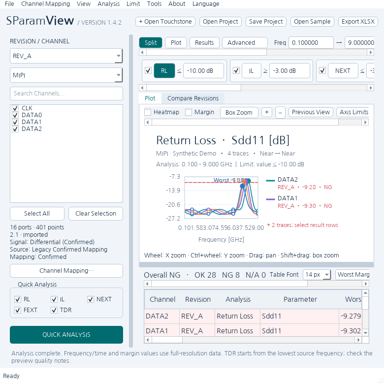

### 4.1 상단 바로가기

v1.4.2 메인 화면의 주요 상단 버튼은 다음과 같습니다. OS, DPI, 창 크기에 따라 배치가 달라질 수 있습니다.

- **+ Open Touchstone**: Touchstone 파일 열기
- **Open Project**: `.siproject` 프로젝트 열기
- **Save Project**: 현재 프로젝트 저장
- **Open Sample**: 포함된 샘플 프로젝트 열기
- **Export XLSX**: 완료된 분석 결과를 Excel Workbook으로 내보내기

### 4.2 왼쪽 Channel 영역

- **REVISION / CHANNEL**: 현재 Revision 선택
- **All groups**: 채널 Group 필터
- **Search Channels...**: 채널 이름 검색
- **Select All / Clear Selection**: 현재 표시 채널 전체 선택/해제
- **Channel Mapping...**: 포트와 논리 채널 매핑 확인/수정
- **Quick Analysis**: RL / IL / NEXT / FEXT / TDR 선택
- **QUICK ANALYSIS**: 체크된 항목을 실행

### 4.3 상단 Analysis / View 영역

- **Split / Plot / Results**: 화면 배치 전환
- **Advanced**: 고급 설정 표시
- **Freq**: 분석 주파수 범위(GHz)
- **Near → Far / Far → Near / Both**: 표시 방향 선택
- **Worst / Top 3 / Top 5 / Off**: 자동 마커 표시 수
- **Channels / Settings / Full Screen**: 패널 및 전체 화면 표시 제어

### 4.4 Plot 및 Results

Plot 영역은 현재 분석 그래프를 보여주며, Results 영역은 채널별 Worst 값, 위치, Margin, 방향 차이, 판정, Aggressor, Quality 등을 표로 표시합니다.

---

## 5. Touchstone 파일 열기

**+ Open Touchstone** 또는 **File > Open Touchstone...**을 사용합니다. `*.s*p`와 `*.ts` 형식을 선택할 수 있으며 여러 파일을 한 번에 열어 Revision으로 비교할 수 있습니다.

파일을 연 뒤에는 **Channel Mapping을 반드시 확인**하십시오. 파일 파싱이 성공해도 포트 이름만으로 Near/Far 또는 P/N 관계를 확실히 판단할 수 없는 경우 자동 매핑이 확정되지 않을 수 있습니다.

SParamView는 원본 Touchstone 파일을 수정하지 않고 로컬에서 읽어 분석합니다.

---

## 6. Channel Mapping

아래 화면은 자동 매핑을 확정할 수 없는 입력을 검증하는 테스트에서 SParamView가 자동 생성한 Channel Mapping 창입니다. 이런 경우 포트 관계를 확인한 뒤 수동 매핑 또는 Mapping CSV로 확정할 수 있습니다.

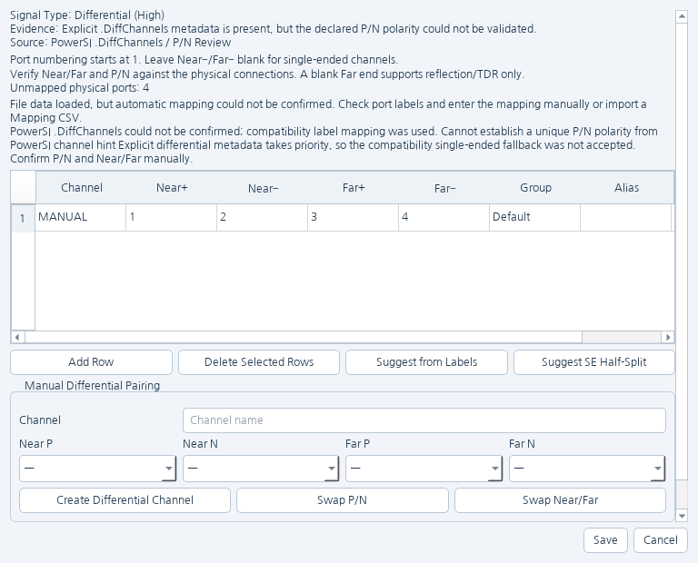

분석 정확도에서 가장 중요한 단계입니다. 잘못된 매핑은 계산 자체가 정상이어도 잘못된 RL/IL/NEXT/FEXT/TDR 결과를 만들 수 있습니다.

### 6.1 기본 규칙

- 포트 번호는 **1부터 시작**합니다.
- Single-ended 채널은 `Near−`, `Far−`를 비워 둡니다.
- Differential 채널은 Near P/N을 한 쌍으로 지정합니다.
- Far P/N을 사용하려면 두 포트를 모두 지정해야 합니다.
- Far 쪽을 비워 둔 채널은 reflection/TDR 중심으로 사용할 수 있습니다.
- Near/Far 및 P/N 방향은 실제 물리 연결과 반드시 대조하십시오.

### 6.2 매핑 창의 주요 열

| 열 | 의미 |
|---|---|
| Channel | 논리 채널 이름 |
| Near+ / Near− | Near-end P/N 포트 |
| Far+ / Far− | Far-end P/N 포트 |
| Group | NEXT/FEXT Aggressor 자동 선택에 사용되는 그룹 |
| Alias | 사용자 별칭 |
| Mapping ID | Revision 사이에서 채널을 식별하기 위한 ID |

### 6.3 편집 기능

매핑 창에서는 행 추가/삭제, Label 기반 제안, Single-ended Half-Split 제안, Differential 채널 수동 생성, P/N 교환, Near/Far 교환을 사용할 수 있습니다. 또한 **Channel Mapping > Import Mapping CSV... / Export Mapping CSV...**로 매핑을 재사용할 수 있습니다.

자동 제안이 불확실하면 기존 데이터를 임의로 확정하지 않고 사용자 확인을 요구합니다. 매핑을 저장하면 해당 Revision의 기존 분석 결과는 무효화되므로 다시 분석해야 합니다.

### 6.4 100 Ω Differential과 50 Ω-to-GND의 차이

다음 두 조건은 서로 다릅니다.

- **Differential P–N 100 Ω**: P와 N 사이의 100 Ω 부하
- **P–GND 50 Ω + N–GND 50 Ω**: P와 N이 각각 GND에 50 Ω로 연결

SParamView의 TDR termination 옵션에서도 두 조건을 별도로 구분합니다.

---

## 7. 분석 실행

### 7.1 Quick Analysis

왼쪽 **Quick Analysis**에서 필요한 항목을 체크한 뒤 **QUICK ANALYSIS**를 누릅니다. 기본 항목은 다음과 같습니다.

- RL
- IL
- NEXT
- FEXT
- TDR

적어도 하나의 분석 항목과 하나 이상의 채널이 선택되어 있어야 합니다. 또한 모든 Revision의 매핑이 확정되어 있어야 합니다.

### 7.2 개별 분석

상단 Settings 영역의 **RL / IL / NEXT / FEXT / TDR** 버튼을 누르면 해당 결과가 이미 현재 설정으로 계산되어 있을 경우 즉시 표시하고, 그렇지 않으면 해당 분석을 계산합니다.

### 7.3 방향 선택

방향 버튼은 다음 세 상태를 순환합니다.

1. **Near → Far**
2. **Far → Near**
3. **Both**

RL/IL의 경우 양 방향 결과가 존재하면 Results의 `Max ΔDir [dB]`, `Δ @ GHz`에서 최대 방향 차이를 확인할 수 있습니다.

---

## 8. RL / IL / NEXT / FEXT 해석

### 8.1 Return Loss

SParamView는 RL 결과를 Single-ended에서는 **S11**, Differential에서는 **Sdd11** 표기와 함께 사용합니다. 현재 Limit 입력은 `≤` 조건입니다. 예를 들어 Limit이 `-10 dB`라면 `-10 dB 이하`의 값이 기준을 만족합니다.

아래 자동 검증 그래프는 synthetic differential sample의 **Sdd11 Return Loss** 예시입니다. 붉은 점선은 활성 Limit이고, 각 trace의 Worst point와 OK/NG 상태를 함께 확인할 수 있습니다.

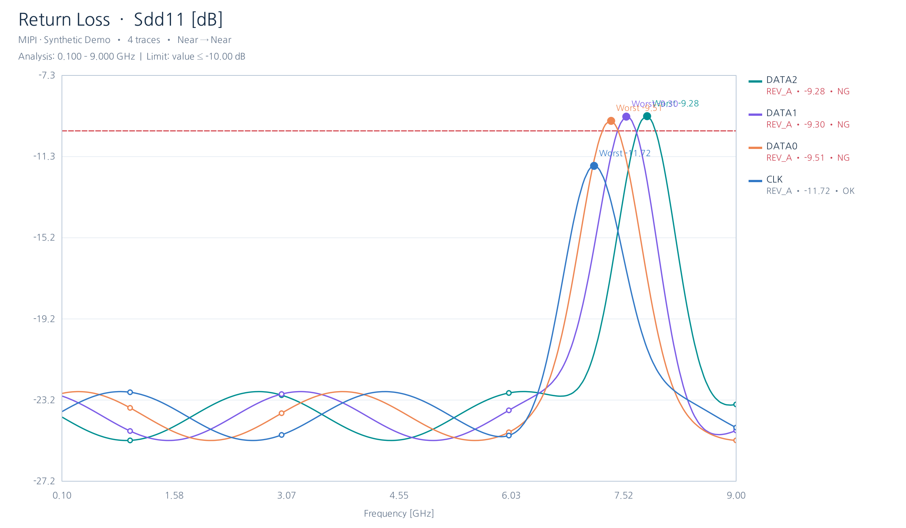

### 8.2 Insertion Loss

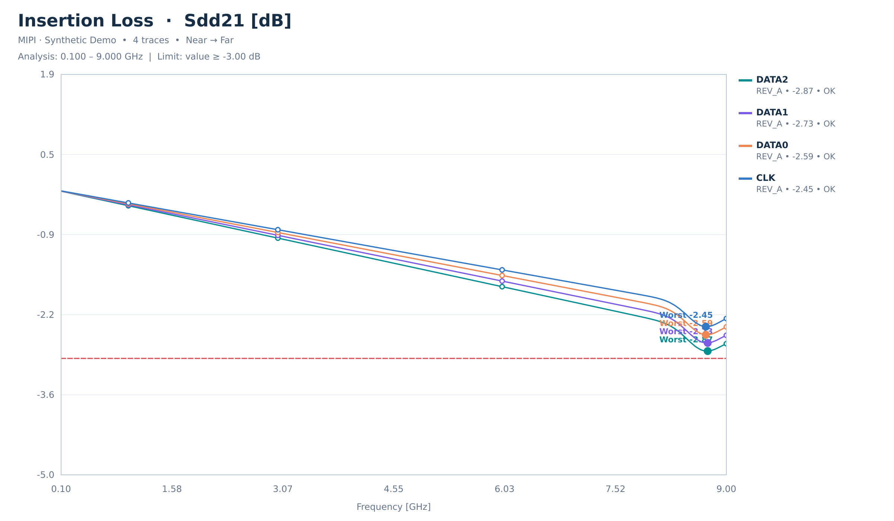


IL은 Single-ended의 **S21**, Differential의 **Sdd21**에 대응하여 표시합니다. 현재 Limit 입력은 `≥` 조건입니다. 예를 들어 `-3 dB` Limit이면 `-3 dB 이상`이 기준을 만족합니다.

### 8.3 NEXT

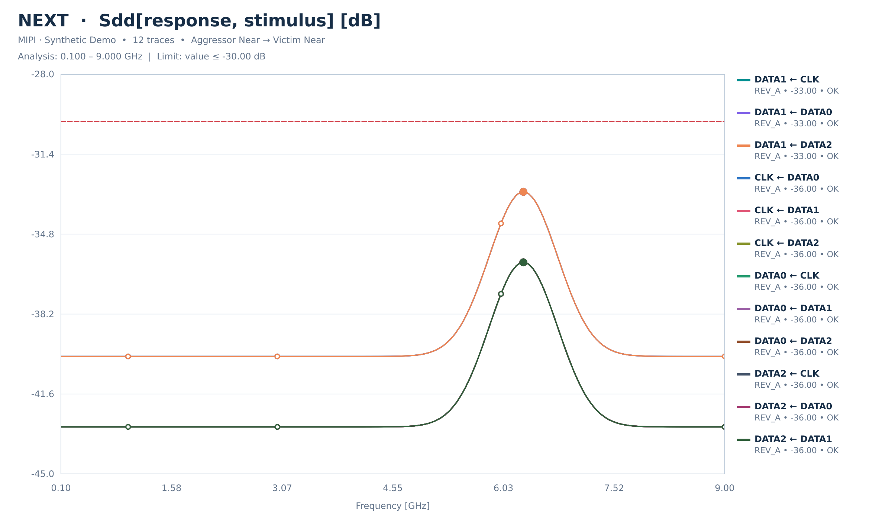


NEXT는 Near-end aggressor가 Near-end victim에 미치는 누화 응답입니다. Limit은 `≤` 조건입니다.

### 8.4 FEXT

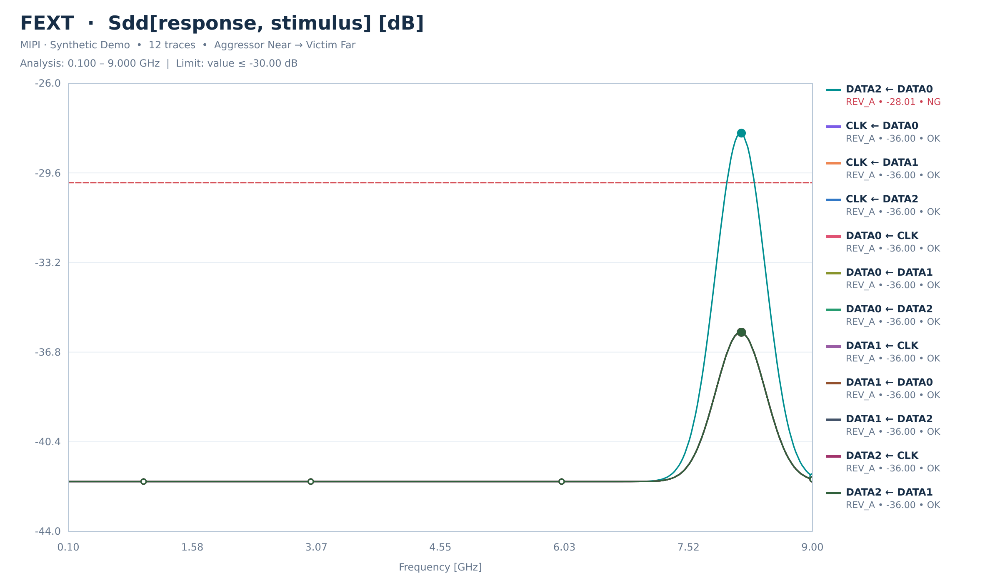


FEXT는 Near-end aggressor가 Far-end victim에 미치는 누화 응답입니다. Limit은 `≤` 조건입니다.

NEXT/FEXT는 기본적으로 **같은 Group에 속한 다른 채널**을 Aggressor 후보로 사용합니다. Advanced의 **Aggressor**에서 특정 채널을 선택할 수도 있습니다.

---

## 9. Limit 및 OK / NG / N/A

Pass/Fail 판정은 사용자가 해당 Limit 체크박스를 활성화했을 때만 의미가 있습니다.

| 분석 | 기본 판정 관계 |
|---|---|
| RL | 측정/계산값 ≤ Limit |
| IL | 측정/계산값 ≥ Limit |
| NEXT | 측정/계산값 ≤ Limit |
| FEXT | 측정/계산값 ≤ Limit |
| TDR | Target Ω ± Tolerance % |

결과 상태는 다음과 같습니다.

- **OK**: 활성화된 Limit을 만족
- **NG**: 활성화된 Limit 위반 검출
- **N/A**: 해당 조건에서 판정을 만들 수 없음

> **N/A는 PASS가 아닙니다.** Limit이 비활성화되었거나, 정의된 주파수 Limit 범위 밖이거나, 판정 조건이 충족되지 않는 경우 N/A가 될 수 있습니다. 요청한 주파수/시간 범위를 입력 또는 계산 결과가 충분히 포함하지 못할 때에도, 검사한 부분에 위반이 없다는 이유만으로 전체를 OK로 판단하지 않습니다. 검사한 부분에서 위반을 찾으면 NG를 유지하며, 위반이 없지만 요청 범위가 불완전하면 N/A로 표시합니다. Results의 설명/툴팁을 함께 확인하십시오.

### 9.1 주파수별 Limit

**Limit > Edit Frequency Limits...** 또는 Advanced의 **Frequency Limit...**을 사용하면 `GHz, dB` 형식으로 여러 점을 입력할 수 있습니다.

```text
1, -10
3, -12
6, -15
```

정의된 점 사이에서는 Limit을 구성할 수 있지만 **정의 범위 밖으로 Limit을 외삽하지 않으며 해당 구간은 N/A**로 취급됩니다. 텍스트를 비우면 constant limit 방식으로 돌아갑니다.

Limit 설정은 JSON Preset으로 저장/불러올 수 있습니다.

---

## 10. Quick TDR

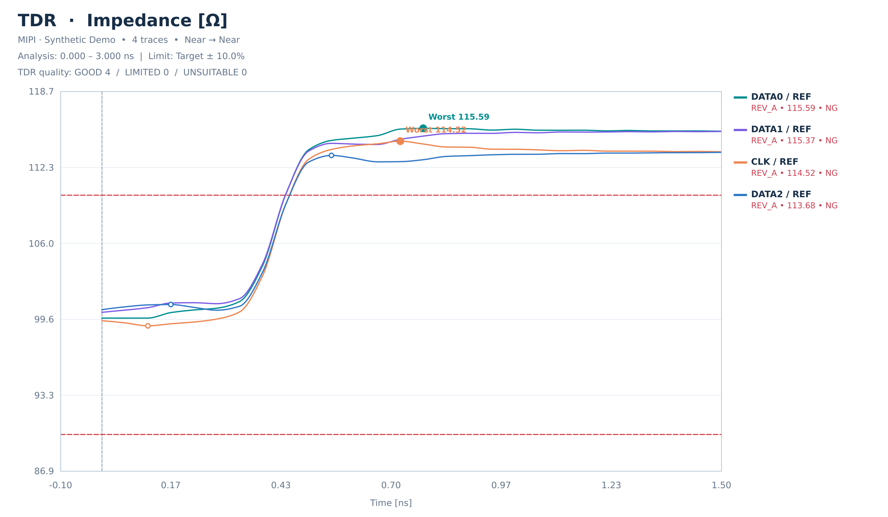


### 10.1 가장 중요한 주의사항

Quick TDR은 Touchstone의 유한한 주파수 대역 데이터를 시간 영역으로 변환해 보는 **빠른 추정 도구**입니다. 결과는 다음 요소의 영향을 받습니다.

- 사용 가능한 주파수 범위와 주파수 간격
- 저주파/DC 정보의 유무와 처리
- 보간/근사 및 windowing
- 채널 매핑
- 기준 임피던스
- 반대쪽 종단 조건

따라서 실제 TDR 계측 결과와 동일하다고 해석하지 마십시오.

### 10.2 Target과 표시 스케일

`Auto Z₀` 사용 시 현재 UI는 Single-ended와 Differential TDR을 별도 스케일로 표시하며 명목상 Single-ended는 **50 Ω**, Differential은 **100 Ω**를 기준으로 사용합니다. 필요한 경우 Target Ω를 직접 지정할 수 있습니다.

### 10.3 TDR Limit

TDR Limit 체크박스를 활성화하면 **Target ± Tolerance %** 기준으로 판정합니다. 예를 들어 100 Ω, ±10%라면 허용 범위는 90~110 Ω입니다.

### 10.4 Termination 옵션

TDR의 톱니바퀴(⚙) 버튼에서 여러 조건을 동시에 선택해 overlay할 수 있습니다.

- **Reference**: source reference impedance에 정합
- **Resistive**: SE 50 Ω / Differential P–N 100 Ω (floating)
- **Grounded**: SE 50 Ω / Differential P–GND 50 Ω + N–GND 50 Ω
- **Open**: SE open / Differential P와 N 모두 open
- **Short**: SE–GND short / Differential P–N short (floating)

Forward 분석에서는 Far 쪽, Reverse 분석에서는 Near 쪽에 선택한 termination을 적용하며 나머지 물리 포트는 source reference impedance에 정합됩니다. Single-ended의 두 50 Ω 조건은 등가이므로 한 번만 계산됩니다.

**Show Reflection Coefficient ρ**를 활성화하면 Open/Short 비교에 유용한 반사계수를 볼 수 있습니다. 이 경우 impedance tolerance Limit은 ρ에 적용되지 않습니다.

### 10.5 초기 표시 범위와 실제 분석 범위

일반적인 0 ns 기반 TDR 결과의 초기 X축은 약 **−0.1 ns~1.5 ns**입니다. 0 ns 왼쪽의 여유는 그래프를 보기 위한 공간이며 음의 시간 데이터를 새로 계산한다는 의미가 아닙니다. 계산 시작점이 0 ns가 아닌 경우에는 첫 계산 샘플보다 약 0.1 ns 앞에서 시작해 약 1.6 ns 폭을 먼저 표시합니다.

**초기 화면, Zoom/Pan, Axis Limits는 표시 범위**를 바꿉니다. 실제 TDR 계산·판정 범위를 바꾸려면 **Advanced > TDR time [ns]**의 Start/Stop을 수정한 뒤 분석을 다시 실행해야 합니다. Stop의 **Auto**는 사용 가능한 계산 범위에 따라 종료 시간을 정합니다. 입력 주파수 간격 등에 따라 실제 계산 가능한 시간 범위는 제한됩니다.

- **Fit All** 또는 Plot에 포커스를 둔 상태에서 **Home**: 현재 계산 결과의 전체 시간 범위를 표시합니다.
- **Previous View** 또는 **Backspace**: 이전 표시 범위로 돌아갑니다.
- TDR 분석 버튼을 다시 누르거나 Single-ended / Differential TDR 보기를 전환하면 초기 표시 범위로 돌아갑니다.
- 같은 데이터 화면에서 Zoom/Pan한 범위는 그래프를 다시 그리거나 상세 데이터를 갱신할 때 유지됩니다.

종단 조건으로 생기는 큰 임피던스 값이 초기 Y축을 과도하게 넓히지 않도록 표시 범위를 조정할 수 있습니다. **자동 축 범위가 어떤 값을 화면 밖에 두더라도 그 값이 계산 결과나 판정에서 삭제된 것은 아닙니다.** 전체 계산 결과를 검토하려면 Fit All과 Results를 함께 확인하십시오.

### 10.6 Quality와 선택 범위 판정

`Quality`는 Quick TDR 계산 조건에 대한 정보이고 `Result`의 OK / NG / N/A와 구분됩니다. **GOOD이 곧 OK 또는 계측 정확도 보장을 의미하지 않습니다.**

| Quality | 해석 |
|---|---|
| GOOD | 계산 경로에서 제한 또는 부적합 조건으로 분류되지 않은 결과입니다. 입력 데이터와 매핑 검토는 여전히 필요합니다. |
| LIMITED | 근사·종단 조건 등으로 해석에 제한이 있는 결과입니다. Results의 설명/툴팁을 확인하십시오. |
| UNSUITABLE | 현재 입력·변환 조건에서 임피던스 평가에 부적합한 결과입니다. 파형을 계산할 수 없거나 무효 샘플이 있을 수 있습니다. |

v1.2.1의 Uniform FFT 경로는 **Advanced에서 선택한 시간 구간 안의 임피던스 샘플**을 기준으로 특이점 여부를 확인합니다. 구간 밖에 특이점이 있다는 이유만으로 정상 선택 구간을 부적합하게 만들지 않습니다. 구간 안에 특이점이 있으면 Reference 종단은 `UNSUITABLE`, 다른 종단 뷰는 기존과 같이 `LIMITED`로 처리될 수 있습니다. 이 수정은 다른 입력·변환·범위 오류까지 무시하는 기능이 아닙니다.

예를 들어 0~1 ns는 약 50 Ω이고 5~6 ns에 특이점이 있는 합성 시험 데이터에서, **TDR time을 0~1 ns로 설정하고 재분석**하면 뒤쪽 특이점 때문에 선택 구간이 부적합해지는 문제를 피할 수 있습니다. 그래프만 0~1 ns로 확대하는 것은 분석 범위를 바꾸지 않습니다. 이 예시는 회귀시험용 합성 데이터이며 모든 실제 입력에서 GOOD 또는 OK를 보장하지 않습니다.

---

## 11. Plot 사용법

Plot은 다음 조작을 지원합니다.

| 조작 | 기능 |
|---|---|
| Mouse Wheel | X축 확대/축소 |
| Ctrl + Wheel | Y축 확대/축소 |
| Drag | Pan |
| Shift + Drag | Box Zoom |
| `+` / `−` | 확대/축소 |
| Home | Fit All |
| Backspace | Previous View |
| Axis Limits | X/Y 범위 직접 지정 |
| Fit All | 전체 데이터 범위로 복귀 |

비-TDR 그래프에서 Heatmap 및 Margin 보기를 사용할 수 있습니다. Plot 위 커서는 현재 위치의 주파수/시간과 표시 trace 값을 보여줍니다.

---

## 12. Results 표 읽기

주요 열은 다음과 같습니다.

- **Channel**: 논리 채널
- **Revision**: 소스 Revision
- **Analysis**: RL / IL / NEXT / FEXT / TDR
- **Parameter**: S11, S21, Sdd11 등 실제 표시 파라미터
- **Worst**: 분석 범위에서의 worst 값
- **GHz / ns**: worst 값 위치
- **Margin**: 활성 Limit 대비 margin
- **Max ΔDir [dB] / Δ @ GHz**: RL/IL 양 방향 최대 차이
- **Result**: OK / NG / N/A
- **Aggressor**: NEXT/FEXT aggressor
- **Quality**: 계산/preview 품질 정보
- **Termination / Unit**: TDR termination 및 Ω/ρ, 또는 dB

상단 Summary는 전체 결과의 OK / NG / N/A 개수를 보여줍니다. 정렬은 **Worst Margin / Worst Value / Channel / Result** 기준으로 바꿀 수 있습니다.

### 12.1 Worst Margin 정렬 읽기

같은 분석 항목 안에서 **Margin이 있는 결과를 먼저, Margin 값이 작은 순서로** 표시합니다. Margin이 없는 결과는 뒤쪽의 별도 그룹에 두고 Worst Value의 심각도 기준으로 정렬합니다. 유효 Margin이 같을 때도 Worst Value 기준을 적용합니다. Margin과 심각도까지 같으면 기존 순서를 유지하므로 채널 이름순까지 보장하는 정렬은 아닙니다.

| 같은 분석 항목의 결과 예 | Margin | Worst Margin 정렬 |
|---|---|---|
| 채널 C | −1 dB | 1번째 |
| 채널 A | 0 dB | 2번째 |
| 채널 B | 없음 | 3번째 |

Margin 없음은 여유가 충분하다는 뜻이 아닙니다. Limit 비활성화나 판정 불가 조건을 확인하십시오. **Worst Value**는 RL/NEXT/FEXT에서 값이 큰 쪽, IL에서 값이 더 작은 쪽, TDR에서 Target Ω로부터 편차가 큰 쪽을 우선합니다.

---

## 13. Revision 비교

여러 Touchstone 파일을 Revision으로 열면 동일 논리 채널을 비교할 수 있습니다.

- 최소 2개 Revision이 필요합니다.
- 모든 Revision의 매핑이 확정되어 있어야 합니다.
- RL/IL/NEXT/FEXT는 비교 결과의 dB 차이를 확인할 수 있습니다.
- TDR은 Compare 표의 dB delta 대신 **Plot overlay**로 비교합니다.

Revision 간 비교를 신뢰하려면 같은 물리 신호가 동일한 논리 Channel/Mapping으로 대응되는지 먼저 확인하십시오.

---

## 14. Project 저장과 복원

### 14.1 저장

상단 **Save Project** 또는 **File > Save Project**를 사용합니다. 새 파일명으로 저장하려면 **File > Save Project As...**를 사용합니다.

`.siproject`에는 분석 설정, Revision 정보, Channel Mapping, 선택 채널, 일부 UI 상태와 원본 Touchstone 경로/해시 정보가 저장됩니다.

> **중요:** `.siproject`는 원본 Touchstone 데이터를 프로젝트 파일 안에 완전히 포함하는 포맷이 아닙니다. 프로젝트를 다른 PC로 옮길 때는 관련 Touchstone 파일도 함께 보관하는 것을 권장합니다.

### 14.2 불러오기

상단 **Open Project** 또는 **File > Open Project...**를 사용합니다. 저장 당시의 상대 경로에서 원본 파일을 찾지 못하면 절대 경로를 확인하고, 그래도 없으면 사용자에게 원본 Touchstone 위치를 다시 지정하도록 요청합니다.

원본 Touchstone의 SHA-256이 저장 시점과 달라졌다면 해당 Revision의 mapping confirmation이 해제될 수 있으므로 다시 확인해야 합니다.

---

## 15. Export

### 15.1 Excel Workbook

**Export XLSX** 또는 **File > Export Excel Workbook...**을 사용합니다. 다음 항목을 선택할 수 있습니다.

- Summary
- Detailed results
- Graphs
- Raw trace data (large)

Raw trace data는 파일 크기가 크게 증가할 수 있습니다.

### 15.2 Plot PNG

**File > Export Plot as PNG...**으로 현재 Plot을 PNG로 저장합니다.

### 15.3 Raw CSV

Results에서 **정확히 한 행**을 선택한 뒤 **File > Export Selected Trace as CSV...**을 사용합니다. 선택된 분석 trace의 raw 데이터를 CSV로 저장합니다.

### 15.4 Mapping CSV

Channel Mapping 메뉴에서 Mapping CSV를 Import/Export할 수 있어 동일 포트 구조의 파일에 매핑을 재사용할 수 있습니다.

---

## 16. Advanced 설정

**Advanced**를 펼치면 다음 항목을 사용할 수 있습니다.

- **Marker [GHz]**: 쉼표로 구분한 수동 주파수 마커
- **Performance**: Low / Normal / Maximum
- **Aggressor**: NEXT/FEXT aggressor 지정, 기본은 `AUTO (same group)`
- **TDR time [ns]**: TDR 표시/분석 시간 범위
- **Peak prominence**: 자동 peak 검출 민감도 관련 설정
- **Frequency Limit...**: 현재 dB 분석 항목의 주파수별 Limit

설정을 변경한 뒤 기존 결과가 남아 있다면 **다시 분석해야 변경값이 계산에 반영**됩니다. Export는 마지막으로 완료된 분석 설정을 사용합니다.

---

## 17. 유용한 메뉴

### File
Touchstone/Project 열기, Project 저장, XLSX/PNG/CSV Export를 제공합니다.

### Channel Mapping
매핑 편집/확정과 CSV Import/Export를 제공합니다.

### View
Split View, Maximize Plot, Maximize Results, Channel List, Analysis Settings, Full Screen, Reset Layout을 제공합니다. `Ctrl+1 / Ctrl+2 / Ctrl+3`으로 주요 workspace 모드를 전환하고 `F11`로 Full Screen을 전환할 수 있습니다.

### Limit
Limit Preset 저장/불러오기와 주파수별 Limit 편집을 제공합니다.

### Tools
- **Open Sample Project**
- **Verify Source SHA-256**: 현재 원본 Touchstone이 분석 시점의 source hash와 일치하는지 확인

---

## 18. 문제 해결

| 증상 | 확인할 내용 |
|---|---|
| Touchstone은 열렸지만 채널 분석이 안 됨 | Channel Mapping이 확정되었는지 확인 |
| Channel Mapping이 자동으로 확정되지 않음 | Port label이 모호할 수 있으므로 수동 매핑 또는 Mapping CSV 사용 |
| QUICK ANALYSIS가 실행되지 않음 | 채널과 분석 항목을 하나 이상 선택했는지 확인 |
| NEXT/FEXT 결과가 없음 | Victim 외에 같은 Group의 유효한 Aggressor와 Near/Far 매핑이 있는지 확인 |
| Result가 N/A | Limit 활성화 여부, 주파수 Limit 범위, 판정 가능 조건 확인 |
| 설정을 바꿨는데 결과가 그대로임 | 설정 변경 후 분석을 다시 실행 |
| TDR 초기 화면에서 뒤쪽 구간이 안 보임 | **Fit All**로 전체 계산 구간 표시; 실제 분석 범위를 바꾸려면 **TDR time [ns]** 수정 후 재분석 |
| 정상처럼 보이는 TDR 구간이 N/A | Quality, Limit, 실제 선택 시간 범위와 계산 가능 범위 확인; 그래프 확대만으로 분석 범위는 바뀌지 않음 |
| Margin 없는 행이 표 아래에 표시됨 | v1.2.1 Worst Margin의 정상 정렬 규칙; Margin 없음과 OK는 별개 |
| TDR가 예상과 크게 다름 | 주파수 span/spacing, mapping, target Z₀, termination, source 품질 확인 |
| Project가 원본 파일을 찾지 못함 | Touchstone 위치를 다시 지정; 파일이 변경되었다면 mapping 재확인 |
| CSV Export가 안 됨 | Results에서 정확히 한 행 선택 |
| XLSX Export가 안 됨 | 먼저 분석을 완료했는지 확인 |
| macOS에서 실행 경고 | 공식 릴리스/SHA-256 확인 후 macOS Privacy & Security 정책 확인 |

문제가 재현된다면 사용한 SParamView 버전, 운영체제/아키텍처, Touchstone 포트 수, 문제 재현 순서와 오류 메시지를 함께 기록하면 원인 분석에 도움이 됩니다.

---

## 19. 샘플 데이터

저장소의 `examples/`에는 UI 및 회귀시험을 위한 synthetic demonstration fixture가 포함되어 있습니다. 실제 제품의 측정 데이터가 아닙니다. **Open Sample** 또는 **Tools > Open Sample Project**로 기본 사용 흐름을 시험할 수 있습니다.

---

## 20. 데이터 및 개인정보

SParamView의 분석 처리는 로컬에서 수행되며 원본 Touchstone 파일은 읽기 전용으로 사용됩니다. Project와 Export 파일은 사용자가 지정한 로컬 경로에 저장됩니다.

---

## 21. 지원 및 라이선스

SParamView 소스는 MIT License로 배포됩니다. Third-party component와 font는 각각의 라이선스를 유지합니다. 자세한 내용은 저장소의 `LICENSE`, `COPYRIGHT.txt`, `third_party/`를 확인하십시오.

문의: **sparamview@gmail.com**

---

## 22. 문서 검증 근거

v1.2.1에서 도입된 과거 기능은 [v1.2.1 릴리스 노트](Release_1.2.1.md)와 다음 소스 자료를 참고했습니다. 현재 버전은 [v1.4.3 릴리스 노트](Release_1.4.3.md), [임시 캐시 정리](Temporary_Cache_Cleanup.md), [변경 이력](Revision_History.md) 및 [v1.4.3 소스](https://github.com/july-rust/SParamView-Public/tree/v1.4.3)를 참고하십시오. 이전 v1.2.4a 검증 기록은 [이전 릴리스 노트](Release_1.2.4a.md)에 보존되어 있습니다.

- [TDR 초기 축 범위 및 자동 스케일](https://github.com/july-rust/SParamView-Public/blob/v1.2.1/src/plot.cpp)
- [그래프 조작 및 초기 화면 복귀](https://github.com/july-rust/SParamView-Public/blob/v1.2.1/src/navigation.cpp)
- [TDR 선택 구간 적합성](https://github.com/july-rust/SParamView-Public/blob/v1.2.1/src/tdr.cpp)
- [결과 정렬](https://github.com/july-rust/SParamView-Public/blob/v1.2.1/src/jobs.cpp)
- [범위 포함 여부 및 OK/NG/N/A 판정](https://github.com/july-rust/SParamView-Public/blob/v1.2.1/src/analysis.cpp)
- [정렬 및 TDR 범위 회귀시험](https://github.com/july-rust/SParamView-Public/blob/v1.2.1/tests/v121_regression_tests.cpp)

---

### 문서 버전

이 설명서는 v1.4.3 기준입니다. [실제 v1.4.3 Native ARM64 검증 자료](https://github.com/july-rust/SParamView-Public/actions/runs/46136603711/artifacts/15259804829)의 `analysis-screenshots/`에서 글꼴을 확인한 최신 ILD, ICN 및 Eye Multi View 화면을 확인할 수 있습니다. Actions 자료는 보관 기간이 제한됩니다. 아래 ILD, ICN 및 Eye 분석 창 3개는 검증된 v1.4.3 화면입니다. 전체 그래프 Export 예시 및 v1.4.2로 명시된 다른 이미지는 이전 버전의 참고 자료입니다.


## 23. v1.4.0 주요 기능과 사용법

- Analysis 메뉴에서 ILD, Generic ICN, Eye Diagram 독립 창을 실행합니다. 매핑된 피해 채널과 경로를 선택하고 Auto Analysis/Auto Preview로 초기 조건을 설정하거나 Run Manual로 실제 조건을 입력합니다. 적용 조건, 품질 경고를 확인하고 CSV/PNG를 내보냅니다.
- ILD는 측정 삽입 손실·적합 곡선·편차를 표시합니다. ICN은 매핑된 NEXT/FEXT 경로, 신호/필터 및 독립 경로 RSS 가정에 따른 누화 적분입니다. Eye Diagram은 대역 제한 NRZ 시뮬레이션이며 측정 BER이 아닙니다. 자동 설정은 실제 PHY 설정의 보증이 아닌 참고용 가정입니다.
- Eye Diagram의 DC 누락 시 시작 주파수 10 kHz 이하는 주파수 기준 확인 없이, 10 kHz 초과~100 kHz 미만은 확인 후 실행하며 100 kHz 이상은 차단합니다. 다른 품질 조건은 계속 적용합니다. AC-like 단일 Pole 외삽은 실제 토폴로지나 장시간 패턴을 보증하지 않습니다.
- Language 메뉴에서 English/Korean/Japanese를 재시작 없이 전환합니다. New는 미저장 변경을 확인하고 작업 공간을 초기화합니다. 복수 Touchstone 파일은 개별 매핑과 순차 처리, 마지막 폴더 및 메인 창 상태 복원을 지원합니다. 분석 창은 화면에 적응하며 설명은 스크롤하고 그래프 영역을 유지합니다. 테이블·Overlay·렌더링을 최적화했습니다.
- 기본 Limit: RL -10 dB, IL -3 dB, NEXT/FEXT -20 dB, TDR -10%; 기본 체크 해제. 규격이 아닌 변경 가능한 예시입니다.
- Windows 사용자 ZIP과 검증용 전체 QA ZIP을 분리했습니다.

**적용 범위:** 엔지니어링 참고용입니다. COM은 개발 보류되어 메뉴에 없으며 IEEE/SNIA/MIPI 적합성, 측정 BER, 모든 물리 장치/HiDPI 검증을 보증하지 않습니다.

[Release notes](Release_1.4.3.md) · [ILD](Channel_Analysis_ILD_012_05.md) · [ICN](Channel_Analysis_ICN_012_06.md) · [Eye Diagram](Channel_Analysis_Eye_012_07.md) · [AC/Auto](qualification/012_54_AC_Auto_Analysis.md).


## v1.4.3 — Auto-to-Manual / Eye Diagram

Auto Analysis/Auto Preview 성공 시 실제 계산에 사용한 설정값을 Manual 영역에 반영합니다. 다른 항목을 수정해도 수정하지 않은 주파수 및 ICN 수치 설정은 계산 정밀도를 유지합니다. 가정값을 검토한 후 실제 조건을 입력하십시오. PHY Profile은 제거되었으며 Eye overlay 세로축에는 TX incident 전압 범위를 포함합니다. COM은 개발 보류 상태입니다.

## v1.4.2 — Eye Diagram Multi View

Eye Diagram에 기존 개별 표시와 함께 **그래프 3개 모두** 옵션을 추가했습니다. Eye overlay (2 UI), TX/RX 파형, Impulse/Unit pulse를 같은 분석 결과에서 표시하며, 독립 축·확대·이동 및 선택한 화면의 PNG Export를 지원합니다. 좁은 화면에서는 세로 배치와 스크롤을 사용합니다. 기존 시뮬레이션 한계는 변경하지 않습니다.

## v1.4.1 — 창 및 작업 공간 동작

- **v1.4.1:** 파일 > 새로 만들기는 저장 확인 후 ILD·ICN·Eye Diagram 창을 닫으며 취소 또는 저장 실패 시 기존 작업을 유지합니다. 파일 > 종료는 기존 저장·캐시 정리 절차를 사용합니다. 창을 현재 모니터의 논리 작업 영역에 맞추며 사용자 정의 대화상자는 본문 스크롤과 하단 고정 버튼을 사용합니다. 파일 선택은 공통 Qt 대화상자를 사용합니다.
고해상도 배율 적용 시 물리 픽셀이 아닌 논리 픽셀을 기준으로 동작합니다. 지나치게 작은 작업 영역은 플랫폼·위젯의 최소 크기 제한을 받을 수 있으며 모든 실제 모니터와 배율 조합에 대한 검증을 의미하지 않습니다.

## 24. 분석 기능별 계산 원리 및 실무 사용법 (v1.4.3)

이 장은 v1.4.3에 실제 구현된 C++ 계산식을 설명합니다. 향후 개발 예정 기능이나 IEEE 적합성 시험 방법을 설명하는 것이 아닙니다. 계산 예시는 수식 이해를 위한 가상 수치이며 아래 화면의 측정 결과가 아닙니다. 화면은 합성 QA 데이터로 생성하며 [이미지 출처](images/README.md)를 참고하십시오. 소스 링크는 변경되지 않는 v1.4.3 Tag를 기준으로 합니다. 내부 연산은 Hz, s, V, Ω를 사용하고 GUI에서는 GHz, ns/ps, mV, dB 등으로 표시합니다.

### 24.1 Touchstone 데이터와 Channel Mapping

1. Touchstone 1.0/1.1/2.0/2.1 S-parameter 파일을 엽니다. 주파수 범위, Reference Impedance, Port 이름과 물리적 방향을 확인합니다. RI, MA, DB 형식은 같은 복소수를 나타냅니다. 각각 $S=x+jy$, $S=M e^{j\theta}$, $S=10^{D/20}e^{j\theta}$입니다. 지수의 위상은 radian이며 Touchstone 파일의 위상은 degree입니다.
2. Revision마다 Single-ended 또는 Differential Channel Mapping을 확인합니다. Differential은 Near P/N과 Far P/N의 극성을 확인합니다. 이름이 비슷하다는 이유로 물리 Pair를 확정하면 안 됩니다.
3. Victim, 필요한 Aggressor, 방향, 주파수/시간 범위를 선택합니다. Quick Analysis 또는 개별 분석을 실행합니다. ILD, ICN, Eye Diagram은 별도의 Analysis 메뉴를 이용합니다.
4. 결과의 Status, Quality, Worst point 및 전체 그래프를 검토하고 Export합니다. Revision 비교는 매핑·방향·종단·기준 임피던스·Limit를 일치시킵니다. 결과가 없는 경우 PASS로 해석하지 않습니다.

동일한 호환 Reference를 갖는 물리 P/N Pair에 대해 Differential power-wave의 단위벡터는 $u=(1,-1)^T/\sqrt2$입니다. 실제 계산되는 차동 응답은 다음과 같습니다.

$$S_{dd}=u_r^T S_{\mathrm{physical}}u_s=\tfrac12(S_{r_p s_p}-S_{r_p s_n}-S_{r_n s_p}+S_{r_n s_n}).$$

$r$은 응답, $s$는 입력 Endpoint입니다. S-parameter의 행은 응답 Port, 열은 입력 Port입니다. Single-ended의 벡터 가중치는 1입니다. 위 식은 실제 구현된 Projection이며 서로 다른 기준 임피던스의 임의 Renormalization이 아닙니다. 물리 Port가 각각 50 Ω이면 차동 Reference는 100 Ω입니다. Quick 분석은 SE와 Differential 간 Cross-mode 누화를 계산하지 않습니다.

측정 주파수 사이의 복소 보간은 $S(f)=(1-a)S_i+aS_{i+1}$, $a=(f-f_i)/(f_{i+1}-f_i)$입니다. dB 값만 보간하는 것이 아니며, 측정 범위를 넘어서는 분석 조건이 새로운 측정값을 만들어내지는 않습니다.

구현 근거: [Trace 및 방향](https://github.com/july-rust/SParamView-Public/blob/v1.4.3/src/trace.cpp), [Endpoint 및 종단](https://github.com/july-rust/SParamView-Public/blob/v1.4.3/src/termination.cpp), [IBIS Touchstone 2.1 규격](https://ibis.org/touchstone_ver2.1/touchstone_ver2_1.pdf).

### 24.2 Return Loss / Insertion Loss / NEXT / FEXT

네 가지 Quick 주파수 분석은 선택된 복소 S-parameter $H(f)$에 대해 $D(f)=20\log_{10}|H(f)|$ dB를 표시합니다. 크기가 0이면 음의 무한대입니다. 일반적으로 양수로 정의하는 Return Loss 및 Insertion Loss는 $-D$입니다. **프로그램의 Quick 그래프는 부호가 있는 S-parameter dB**를 사용합니다.

| 분석 | Forward (Near → Far) | Reverse (Far → Near) | 양호한 경향 |
|---|---|---|---|
| RL | Victim Near 반사: S11/Sdd11 | Victim Far 반사: S22/Sdd22 | 더 음수 |
| IL | Victim Near 입력 → Far 출력: S21/Sdd21 | S12/Sdd12 | 수동 Through 경로에서 0 dB에 가까울수록 |
| NEXT | Aggressor Near 입력 → Victim Near 응답 | Aggressor Far → Victim Far | 더 음수 |
| FEXT | Aggressor Near 입력 → Victim Far 응답 | Aggressor Far → Victim Near | 더 음수 |

예를 들어 $|S_{11}|=0.1$이면 -20 dB (양수 Return Loss 20 dB)이며 반사 power-wave 전력 비율은 $|S_{11}|^2=1\%$입니다. $|S_{21}|=0.5$이면 약 -6.02 dB이며 호환되는 power-wave 기준에서 전달 전력 비율은 25%입니다. 누화 응답 크기 0.01은 -40 dB, 전력 비율 0.01%입니다. 이는 Wave 비율이며 임피던스 부정합 회로의 실제 부하 전압 또는 소비 전력과 동일하다고 단정하면 안 됩니다.

Both 방향을 선택했을 때 RL/IL의 방향 차이는 공통 주파수 범위에서 복소 보간을 적용한 $\max_f|D_{\rm forward}(f)-D_{\rm reverse}(f)|$입니다. 차이가 크면 비대칭이나 매핑 이상을 확인할 수 있으나 독립적인 적합성 판정 기준은 아닙니다. 호환되는 정규화 조건에서 상호적인 회로의 전달 응답은 같을 수 있지만 양단 반사는 다를 수 있습니다.

구현 근거: [trace.cpp](https://github.com/july-rust/SParamView-Public/blob/v1.4.3/src/trace.cpp).

### 24.3 Limit 및 Worst Margin 계산

기본 예시 값은 RL -10 dB, IL -3 dB, NEXT/FEXT -20 dB, TDR 허용 오차 10%입니다. 체크박스는 처음에 해제되어 있습니다. 실제 인터페이스 규격에 맞는 Limit를 직접 입력해야 합니다.

계산된 $D(f)$와 Limit $L(f)$로부터 Margin은

$$m(f)=\begin{cases}D(f)-L(f),&\text{IL}\\ L(f)-D(f),&\text{RL, NEXT, FEXT}\end{cases}$$

이며 Worst Margin은 평가된 Margin의 최솟값입니다. 주파수별 Limit는 입력된 dB 값 사이를 선형 보간하며 정의된 범위를 벗어나면 외삽하지 않습니다. TDR Margin은 Ω 단위의 $m(t)=Z_{\rm target}p/100-|Z(t)-Z_{\rm target}|$입니다 ($p$: 허용 오차 %).

예시: RL -14 dB, Limit -10 dB이면 +4 dB입니다. IL -4 dB, Limit -3 dB이면 -1 dB입니다. TDR Target 100 Ω, 허용 오차 10%이면 범위는 90~110 Ω이며 112 Ω 지점의 Margin은 -2 Ω입니다. 위반이 검출되면 다른 결과 일부가 없더라도 NG이고, 위반이 없지만 데이터 부족·유효하지 않은 값·범위 부족 등이 있으면 N/A입니다. OK는 설정된 공학적 Limit를 만족했다는 뜻이지 표준 인증을 의미하지 않습니다.

구현 근거: [analysis.cpp](https://github.com/july-rust/SParamView-Public/blob/v1.4.3/src/analysis.cpp), [Limit 보간](https://github.com/july-rust/SParamView-Public/blob/v1.4.3/src/termination.cpp).

### 24.4 Quick TDR — 반사 응답으로 임피던스 계산

TDR을 선택한 후 Reference 또는 반대쪽 종단 조건, Target 임피던스, 실제 분석 시간 범위를 설정합니다. 화면의 확대 범위와 분석 범위는 구분합니다. Quality를 확인한 후 임피던스를 해석합니다. Reference 종단은 나머지 물리 Port가 Reference에 정합된 원본 S-parameter를 유지합니다. 다른 종단은 매핑된 반대쪽 Endpoint에 적용합니다.

기준 임피던스 $Z_0$, 계산된 실수 Step Reflection $\rho(t)$에 대해

$$Z(t)=Z_0\frac{1+\rho(t)}{1-\rho(t)}.$$

예를 들어 100 Ω Reference에서 $\rho=+0.1$이면 122.22 Ω, $\rho=-0.1$이면 81.82 Ω입니다. 반사 Step이 양수이면 추정 임피던스가 증가하고 음수이면 감소합니다. Open 부근의 특이점은 유효한 유한 임피던스가 아닙니다.

구현에서는 균일 주파수 Grid에 복소 보간 후 Kaiser Window $W(u)=I_0(\beta\sqrt{1-u^2})/I_0(\beta)$ ($u=f/f_{\max}$, $I_0$: 수정 Bessel 함수)를 적용합니다. Hermitian 대칭으로 음수 주파수를 구성하고 IFFT, 시간 원점 이동, Impulse 누적 사다리꼴 적분을 수행합니다. 시간 샘플 간격은 $\Delta t=1/(2f_{\max})$, 주기적 FFT 시간 범위는 $1/\Delta f$입니다. 실제 선택 가능한 양의 시간 구간은 $0.45/\Delta f$까지 제한합니다. 샘플 간격이 계측기의 분해능을 의미하는 것은 아닙니다. DC가 누락된 경우 첫 두 실수 반사 샘플로 선형 DC 외삽을 수행하고 DC는 실수로 강제합니다. 저주파 Gap이 상한 주파수의 10%를 초과하거나 DC 값이 비정상인 경우 차단합니다.

균일 Grid의 절대 복소 S 오차가 0.05를 초과하면 원래 주파수 구간을 사용하는 비균일 Step 적분으로 전환합니다.

$$\rho(t)=\frac{\Re S(0)}2+\int_0^{f_{\max}}\frac{W(f)[\Re S(f)\sin(2\pi ft)+\Im S(f)\cos(2\pi ft)]}{\pi f}\,df.$$

적분 차수와 보간 민감도를 비교하며 수치 조건을 만족하지 않는 경우 결과 품질을 제한합니다. 이는 계측기 정확도 규격이 아닌 Preview 수치 기준입니다. 고주파 대역이 넓을수록 짧은 구조를 분리하는 데 유리하지만 DC 누락, 주파수 간격, Noise 및 Window의 영향을 받습니다. 전파 속도 $v_p$를 별도로 알고 있을 때 반사 왕복 시간으로부터 거리 $d=v_pt/2$를 추정할 수 있습니다. 이는 공학적 거리 환산 예시이며 프로그램이 유전율이나 실제 거리를 자동 측정한다는 뜻이 아닙니다.

반대편 물리 종단은 구동 Port 및 종단 Port로 S 행렬을 분할한 후 $a_L=\Gamma_L b_L$ 경계조건으로 $(I-\Gamma_L S_{LL})a_L=\Gamma_L S_{LN}a_N$을 풀고 $b_N=S_{NN}a_N+S_{NL}a_L$을 계산합니다. 비특이 조건의 등가 반사식은

$$S_{\rm eff}=S_{NN}+S_{NL}(I-\Gamma_L S_{LL})^{-1}\Gamma_L S_{LN}.$$

단일 저항 종단은 $\Gamma_L=(R-Z_0)/(R+Z_0)$이며 Open은 +1, Short는 -1입니다. Floating P–N 100 Ω과 P/N 각각 50 Ω-to-GND는 Common-mode 경계조건이 다르므로 동일 종단으로 취급하지 않습니다. 해가 일치하지 않거나 입력 응답이 유일하지 않은 경우 차단합니다.

구현 근거: [tdr.cpp](https://github.com/july-rust/SParamView-Public/blob/v1.4.3/src/tdr.cpp), [termination.cpp](https://github.com/july-rust/SParamView-Public/blob/v1.4.3/src/termination.cpp).

### 24.5 ILD (Insertion Loss Deviation)

**Analysis → ILD**를 선택합니다. 확인된 소스, Victim, 방향을 지정하고 Auto Analysis를 실행하거나 Run Manual에서 주파수 범위와 Fit Model을 설정합니다. 그래프에서 양수 Insertion Loss 및 Fitted Loss, 부호 있는 Deviation을 확인합니다. 실제 적용 주파수 범위, RMS, Peak Absolute 및 해당 주파수를 확인합니다. 같은 모델과 주파수 조건에서는 편차가 작을수록 유리하지만 절대 IL이 낮다는 보장은 아닙니다.

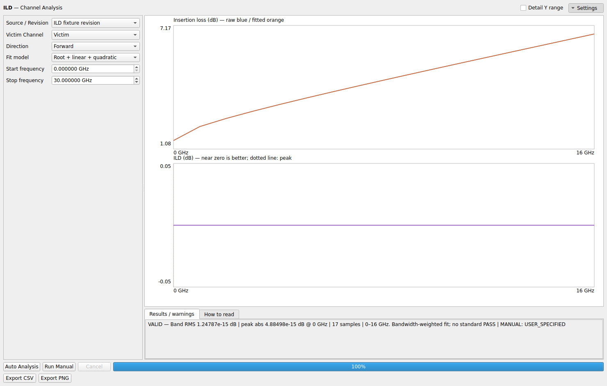

Quick IL과 달리 ILD는 양수 Loss $A(f)=-20\log_{10}|H(f)|$를 사용합니다. $F$는 선택된 측정 데이터의 마지막 주파수이며 $x=f/F$로 정규화합니다. 세 가지 Fit Model은

$$\widehat A=a_0+a_1x,\qquad \widehat A=a_0+a_1\sqrt{x}+a_2x,\qquad \widehat A=a_0+a_1\sqrt{x}+a_2x+a_3x^2.$$

기본 모델은 Root-linear입니다. 이는 매끄러운 손실을 근사하기 위한 공학적 모델로, 계수 자체를 동박·유전체의 직접 측정값으로 해석하면 안 됩니다. 측정 대역폭 $B=f_{\rm last}-f_{\rm first}$로 정규화한 사다리꼴 Cell 가중치 $w_i=(\Delta f_{\rm left}+\Delta f_{\rm right})/(2B)$를 사용하여 $\sum_iw_i(A_i-\widehat A_i)^2$를 최소화합니다. 양쪽 끝에서 없는 구간은 0입니다. 직접 역행렬 대신 두 번 재직교화한 Modified Gram–Schmidt QR로 계산합니다.

편차는 $e_i=A_i-\widehat A_i$, 최대 절대 편차는 $\max_i|e_i|$입니다. RMS는 선형 연결된 편차를 제곱하여 대역폭 전체에 대해 적분합니다.

$$e_{\rm RMS}=\sqrt{\frac1B\sum_i\frac{f_{i+1}-f_i}{3}(e_i^2+e_ie_{i+1}+e_{i+1}^2)}.$$

예시: +0.5 dB 편차는 측정 양수 Loss가 Fit보다 0.5 dB 크고, -0.5 dB 편차는 0.5 dB 작습니다. 한 구간의 편차가 -1에서 +1 dB로 선형 변화하면 구간 RMS는 $1/\sqrt3\approx0.577$ dB입니다. 프로그램은 실제 범위 안의 측정 Bin만 사용하며 Zero Transfer, 부족한 샘플, Rank 부족 Fit 등을 차단합니다. Auto ILD는 관측된 AC-like Pole이 있으면 시작 주파수를 Pole의 10배 이상으로 올릴 수 있습니다. 누락된 손실을 외삽하지 않습니다. 동일 대역 및 모델로 비교해야 하며 IEEE weighted FOM_ILD가 아닌 Generic ILD입니다.

구현 근거: [ild.cpp](https://github.com/july-rust/SParamView-Public/blob/v1.4.3/src/channel_analysis/ild.cpp), [ILD 수치 검증 기록](Channel_Analysis_ILD_012_05.md).

### 24.6 ICN (Integrated Crosstalk Noise)

**Analysis → ICN**에서 Victim, 방향, NEXT/FEXT Aggressor 경로(1~32개)를 선택합니다. Auto Analysis는 참고용 조건을 사용합니다. 실제 Baud, TX Vpp, Rise Time(10~90%), RX 대역폭과 적분 범위를 알고 있으면 Run Manual을 사용합니다. 다중 경로는 Independent/RSS 가정을 활성화해야 합니다. **All three graphs**에서 Power Sum, Weighted Noise PSD, Cumulative RMS를 함께 확인할 수 있습니다. 초기 화면은 Total 포함 Cumulative RMS입니다.

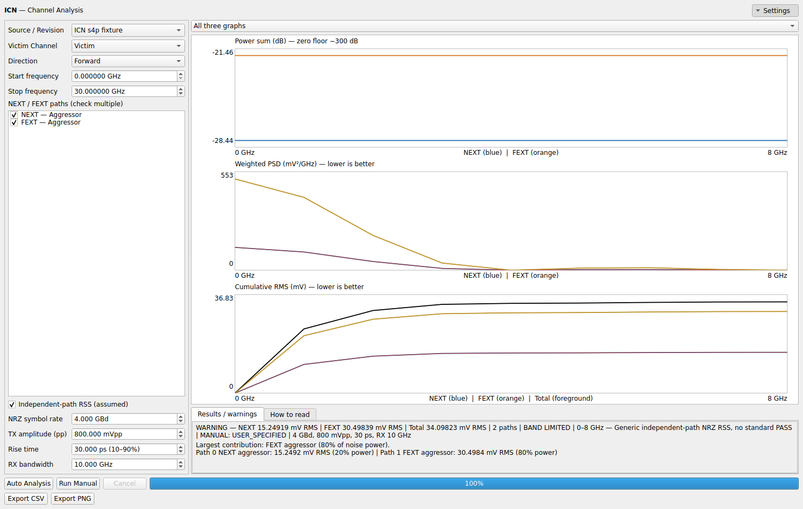

동일 확률의 독립적인 평균 0 NRZ Symbol에 대해 $T=1/R_s$, $\sigma_V=V_{pp}/2$, $\sigma_t=t_{10-90}/2.5631031310892007$, $\mathrm{sinc}(x)=\sin(x)/x$로 정의합니다. 실제 구현된 단측 Weighted PSD(V²/Hz)는

$$P(f)=2\sigma_V^2T\mathrm{sinc}^2(\pi fT)\exp[-(2\pi f\sigma_t)^2]\frac1{1+(f/f_{\rm RX})^2}.$$

각 경로의 전달 응답 $H_k(f)$에 대해 출력 PSD는 $P_k(f)=|H_k(f)|^2P(f)$입니다. Power Sum은 가중 전의 $10\log_{10}\sum_k|H_k|^2$이며 -300 dB는 화면에만 적용되는 하한입니다. PSD 그래프는 mV²/GHz 단위이며 1 V²/Hz = $10^{15}$ mV²/GHz입니다. Cumulative Noise는 측정 대역의 교집합에서 사다리꼴 적분합니다.

$$V_k(f_j)=\sqrt{\sum_{i<j}\tfrac12[P_k(f_i)+P_k(f_{i+1})]\cdot(f_{i+1}-f_i)},\quad V_{\rm total}=\sqrt{V_{\rm NEXT}^2+V_{\rm FEXT}^2}.$$

각 경로 기여율은 Total이 0이 아닐 때 $100(V_k/V_{\rm total})^2$입니다. 예를 들어 독립 NEXT 3 mV RMS, FEXT 4 mV RMS이면 Total은 7 mV가 아니라 5 mV이며 각각의 전력 기여율은 36%, 64%입니다. 상관된 Aggressor를 단순 RSS로 계산할 수는 없습니다.

Auto 조건은 Cap=min(10 GHz, 측정 최대 주파수), Symbol Rate=min(4.5 GBd, Cap/1.5), TX 400 mVpp, Rise Time 30 ps, RX Bandwidth=Cap입니다. 실제 회로의 TX 조건을 자동 추출한 값이 아닙니다. 측정 대역에서만 적분하며 누락된 DC 및 대역 밖 Noise를 외삽하지 않습니다. Reference 불일치 및 주파수 Grid 불일치는 차단합니다. 같은 조건에서는 결과가 낮을수록 유리하지만 보편적인 ICN 합격 Limit 또는 IEEE/SNIA 적합성을 의미하지 않습니다.

구현 근거: [icn.cpp](https://github.com/july-rust/SParamView-Public/blob/v1.4.3/src/channel_analysis/icn.cpp), [ICN 수치 검증 기록](Channel_Analysis_ICN_012_06.md).

### 24.7 Eye Diagram — NRZ 시뮬레이션

**Analysis → Eye Diagram**에서 Source, 물리 Mapping, 방향을 확인합니다. Auto Preview로 빠르게 분석하거나 Manual 설정의 Bit Rate, Analysis Cap, Pattern, FFT Length, Samples/UI, TX/RX 전기 조건을 확인하고 Run Manual을 실행합니다. 가정과 DC 상태, RX 입력 범위, Eye Height, Eye Width 및 경고를 함께 봅니다.

- **Eye overlay (2 UI)**: RX 파형을 위상 정렬하여 중첩합니다. Threshold와 High/Low Envelope 또는 Sampling Marker를 확인합니다. 동일 조건에서 Eye가 높고 유효 위상 구간이 넓을수록 유리한 경향입니다.
- **TX / RX waveform**: 원래 입력 대비 수신 진폭, 지연, Ringing, ISI(Inter-Symbol Interference)를 확인합니다.
- **Impulse / Unit pulse**: 정규화된 Impulse와 1 UI 높이 1 Pulse의 채널 응답입니다. 응답 Tail로 이전 Symbol이 뒤 Symbol에 미치는 영향을 파악합니다.
- **All three graphs**: 위 세 그래프가 하나의 동일한 분석 결과를 공유합니다. 표시 모드를 바꿔도 재분석하지 않습니다. 넓은 화면에서는 보조 그래프를 나란히 배치하고 좁은 화면에서는 세로로 쌓아 스크롤합니다. 각 그래프의 마우스 Wheel 확대, Drag 이동, Double Click 초기화는 독립적입니다. PNG Export는 선택된 개별 또는 전체 View를 저장하며 CSV는 원본 수치 데이터를 유지합니다.

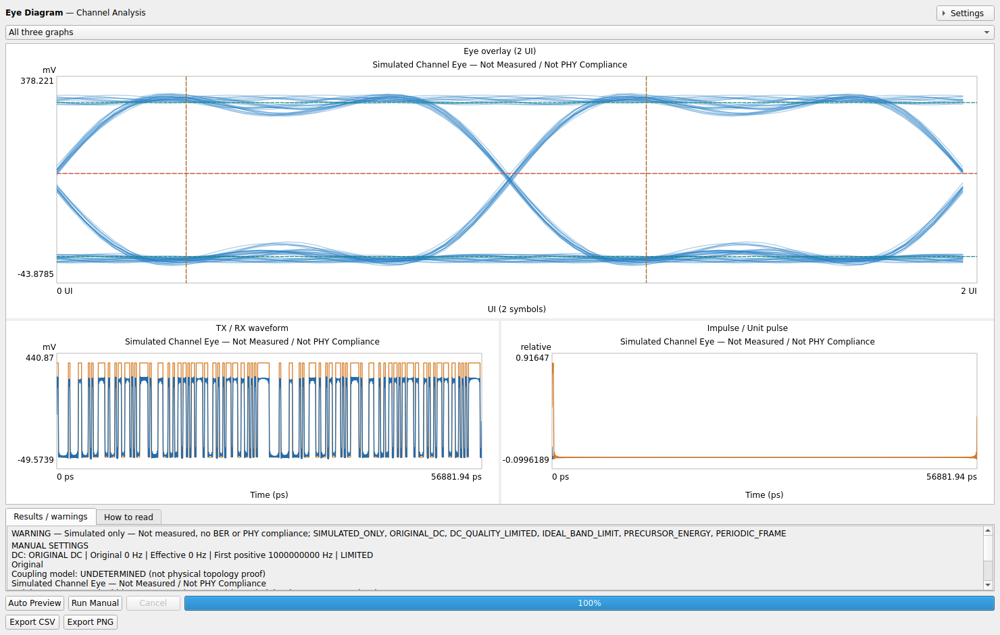

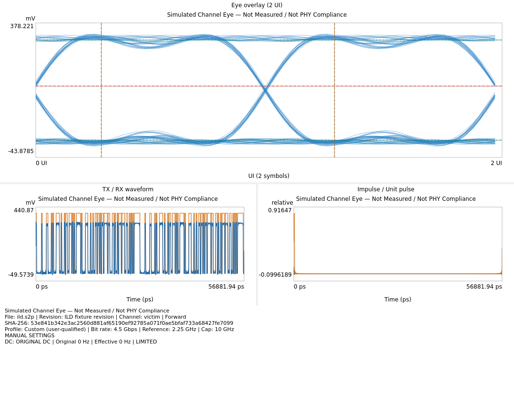


NRZ Bit Rate $R_b$, Samples/UI $M$, FFT Length $N$에 대해

$$UI=1/R_b,\quad f_{\rm ref}=R_b/2,\quad f_s=MR_b,\quad \Delta t=1/f_s,\quad \Delta f=f_s/N.$$

Analysis Cap은 Reference Frequency와 독립적이며 측정 데이터 및 시뮬레이션 Nyquist 범위 안에 있어야 합니다. 복소 선형 보간, DC 조건화, Hermitian Spectrum을 구성하고 Cap 이상은 0으로 둡니다. 이는 실제 대역 밖 측정값이 아니라 이상적인 대역 제한 **시뮬레이션 가정**입니다. 구성한 전달 함수 $H[k]$로부터

$$h[n]=\mathrm{IFFT}\{H[k]\},\quad y[n]=\Re\{\mathrm{IFFT}(\mathrm{FFT}(x[n])H[k])\}.$$

입력 $x$는 $N/M$ Bit의 유한 NRZ Frame을 반복합니다. Unit Pulse는 첫 $M$개 샘플이 1, 이후가 0인 신호를 동일 전달 함수에 통과시킵니다. Impulse 에너지 최대 샘플의 Index $d$에서 추정 지연은 $d\Delta t$입니다. 원형 지연이나 수치 조건이 유효하지 않으면 차단합니다. 이는 유한 주기 Convolution이며 긴 무작위 패턴이나 측정 Jitter 분포가 아닙니다.

각 위상 $p=0,\ldots,M-1$에서 High Bit의 최소 수신값 $H_{\min}(p)=\min_{b_i=1}y[(iM+d+p)\bmod N]$, Low Bit의 최대 수신값 $L_{\max}(p)=\max_{b_i=0}y[(iM+d+p)\bmod N]$를 계산합니다.

$$\text{Eye Height}=\max_p[H_{\min}(p)-L_{\max}(p)],$$

$$O(p)=[H_{\min}(p)>V_{\rm th}\ \text{and}\ L_{\max}(p)<V_{\rm th}],\qquad
\text{Eye Width}_{UI}=\frac{\text{longest circular run of true }O(p)}{M}.$$

Eye Width(sec)는 Eye Width(UI)에 UI를 곱한 값입니다. 최대 Height 위상이 Threshold를 만족하지 않을 수 있으며 프로그램은 별도 경고합니다. Overlay는 주기적 Frame 전체에서 최대 64개의 실제 Segment를 선택하며, 존재하는 00/01/10/11 인접 비트 조합과 최대 Height 위상을 결정하는 High/Low 파형을 포함합니다. 수치 계산은 유한 Frame 전체를 사용하며 Overlay는 전체 Eye Envelope가 아닙니다. Width는 샘플 위상의 추정값이며 BER Contour가 아닙니다.

계산 예시: 4.5 Gbps에서 UI=222.22 ps, Reference=2.25 GHz입니다. $M=32$, $N=8192$이면 샘플 간격 6.944 ps, Sample Rate 144 GHz, 주파수 Bin 간격 17.578125 MHz, Frame은 256 Bit(56.889 ns)입니다. 가상 High 최소 +120 mV, Low 최대 -80 mV이면 해당 위상의 높이 차이는 200 mV입니다. Threshold 0 mV에서 연속 유효 위상이 24개면 Eye Width는 0.75 UI(166.67 ps)입니다.

Auto Preview는 PRBS7, TX -200/+200 mV(400 mVpp Incident Wave), 동일한 실수 Reference 정합, Threshold 0 mV, RX 선형 범위 -1000/+1000 mV를 가정합니다. Cap=min(10 GHz, 측정 최대), Bit Rate=min(4.5 Gbps, Cap/1.5)입니다. Manual은 실제 Low/High 전압, 정합 TX/RX Reference, RX 선형 범위 및 Threshold를 입력해야 합니다. 서로 다른 Reference의 Renormalization은 이 엔진에서 지원하지 않습니다. PHY Profile을 선택하거나 추정하지 않으며 PHY 적합성 시험이 아닙니다. Auto Preview는 실제 계산에 사용된 설정값을 Manual 영역에 반영합니다. 수정하지 않고 Run Manual을 실행하면 동일한 설정을 사용합니다. Eye overlay의 세로축에는 비교 기준으로 TX incident 전압 범위를 포함합니다.

구현 근거: [eye.cpp](https://github.com/july-rust/SParamView-Public/blob/v1.4.3/src/channel_analysis/eye.cpp), [Eye GUI 및 Export](https://github.com/july-rust/SParamView-Public/blob/v1.4.3/src/gui/analysis/analysis_windows.cpp).

### 24.8 Eye Diagram의 DC Extrapolation과 AC Coupling

DC가 없는 Touchstone 파일에 대한 주파수 기준은 다음과 같습니다.

| 원래 시작 주파수 | 처리 |
|---|---|
| 10 kHz 이하 | 주파수 기준 확인 없이 진행, 다른 품질 검사는 유지 |
| 10 kHz 초과~100 kHz 미만 | 제한된 외삽 경고 및 명시적 확인 필요 |
| 100 kHz 이상 | 실행 차단 |

0 Hz 값이 있다고 항상 신뢰할 수 있는 것은 아닙니다. DC 일관성과 근접 데이터의 품질을 평가하며 희소 DC는 별도 취급합니다. 지원되는 국소 Even-real Fit와 Constant/대체 Fit 비교로 DC를 조건화하고, 관측된 AC-like Pole을 검증한 경우 $H_{\rm RC}(f)=G(jf/f_p)/(1+jf/f_p)$를 첫 측정점에 맞추어 사용할 수 있습니다. 측정된 복소 샘플 자체는 유지합니다. 이 모델은 물리적인 AC Coupling Capacitor 토폴로지를 증명하지 않습니다.

이상적 Pole의 Time Constant $\tau=1/(2\pi f_p)$, 시간 $t$의 Step 감소 비율은 $1-e^{-t/\tau}$입니다. $n$ Bit 연속 구간의 경우 $t=n\,UI$입니다. 별도 Long-step 모델은 두 개 FFT Grid의 수치 결과를 비교하지만 실제 긴 패턴의 Baseline Wander를 보증하지 않습니다. 따라서 짧은 Frame에서 Eye가 열려 있다는 이유만으로 AC Coupled 채널을 합격 처리할 수 없습니다. 1 kHz 시작은 첫 정책 범위에 속하지만 정확도를 보장하는 것은 아닙니다.

구현 근거: [eye.cpp의 DC/Long-run 모델](https://github.com/july-rust/SParamView-Public/blob/v1.4.3/src/channel_analysis/eye.cpp), [DC 검증](qualification/012_52_Eye_DC_Qualification.md), [AC/Auto 검증](qualification/012_54_AC_Auto_Analysis.md).

### 24.9 SI 실무 판단 체크리스트

- 비교 조건은 원본 Source, Reference, Mapping, 방향, 대역, Fit, TX/RX 조건, Limit를 동일하게 유지합니다. 시간 영역 분석은 특히 복소 위상 및 Reference가 중요합니다.
- 절대 IL, RL, TDR을 함께 확인합니다. Eye가 크고 ILD/ICN이 작아도 해당 PHY의 Mask, RX Model, 측정 BER 또는 표준 규격 시험을 대체하지 않습니다.
- 가능한 경우 전체 수치 CSV/Excel 및 Source SHA-256, 분석 조건을 보관합니다. PNG는 시각적 기록이며 전체 수치 자료가 아닙니다. Source/Mapping 변경은 관련 결과를 무효화합니다.
- COM은 연구 코드만 보존한 개발 보류 기능이며 운영 메뉴에서 제공하지 않습니다. ILD, ICN, Eye 결과로 COM을 임의 추정하지 않습니다.
- 공식 v1.4.2 [3개 플랫폼 릴리즈 CI](https://github.com/july-rust/SParamView-Public/actions/runs/46093773220) 및 [CodeQL](https://github.com/july-rust/SParamView-Public/actions/runs/46093773213)은 통과했습니다. 모든 실제 모니터/DPI 조합, 물리 PCB, 장시간 패턴, 계측기 등가 정확도에 대한 인증은 아닙니다.

## 부록 A. 이전 버전별 주요 변경 기록

### v1.2.1에서 알아둘 변경사항

| 항목 | 사용 시 달라진 점 |
|---|---|
| 입력 검증 | 잘못된 숫자·범위와 모호한 입력 조건을 안전하게 거부합니다. 오류가 나면 입력과 설정을 확인하십시오. |
| TDR 초기 화면 | 일반적인 0 ns 기반 결과는 약 −0.1~1.5 ns를 먼저 보여줍니다. 전체 계산 구간은 **Fit All**로 확인합니다. |
| TDR 선택 범위 | Uniform FFT 경로에서 선택 시간 범위 밖의 임피던스 특이점이 정상 선택 구간까지 `UNSUITABLE`로 만들던 문제를 수정했습니다. |
| Worst Margin 정렬 | 같은 분석 항목 안에서 Margin이 있는 결과를 먼저 표시하고, Margin이 없는 결과는 별도 그룹으로 정렬합니다. |

v1.2.0의 기능별 소스 분할은 내부 코드 구조 변경입니다. 사용자가 파일을 나누거나 별도로 설정할 필요는 없습니다. 세부 변경 이력은 [v1.1.6](Release_1.1.6.md), [v1.1.7](Release_1.1.7.md), [v1.2.0](Release_1.2.0.md), [v1.2.1](Release_1.2.1.md)을 참고하십시오.

---

### v1.2.4a 사용 흐름 변경

- 안내가 나오면 Channel Mapping 전에 **Signal Type Detection**을 검토합니다. Single-ended를 선택하면 **Suggest from Labels**에서도 이름 기반 P/N 추론이 꺼진 상태를 유지합니다. 명시적 `.DiffChannels`와 Mixed-Mode descriptor는 별도 근거입니다. 필요한 경우 Near/Far를 직접 확인하고 대화상자의 미매핑 포트 수도 확인하십시오.
- 분석 버튼은 현재 선택 채널·필터·Aggressor에 맞춰 계산합니다. 완료된 동일 요청은 재사용합니다. Metric 선택은 기존 결과의 조회만 변경하며 새 분석을 실행하지 않습니다. Direction 버튼은 계산된 방향의 표시를 전환합니다.
- 프로젝트를 열 때 현재 원본 전체 SHA-256을 검증합니다. 원본 변경 시 기존 확정 매핑을 해제하고 현재 원본에서 생성한 후보를 다시 검토합니다. 매핑 오류만으로 유효한 원본을 버리지 않습니다.
- 설정·마커·채널 선택·검색·Aggressor 변경은 저장 상태에 반영됩니다. 프로젝트 전환에서 Save / Discard / Cancel을 선택할 수 있으며 저장 취소·실패 시 현재 프로젝트를 유지합니다.
- Excel Configuration에는 신호 종류·신뢰도·근거·매핑 출처 및 확인 상태, 원본 SHA-256 및 검증 상태, 분석 완료 시각·보고서 생성 시각, 실제 분석 설정 스냅샷을 기록합니다. 분석 후 바꾼 설정을 기존 결과의 계산 조건으로 표시하지 않습니다.
- 첫 번째 이후 Touchstone 옵션 줄은 진단을 남기고 무시합니다. 첫 옵션의 해석을 유지하며 대칭 Lower/Upper mixed-mode 행렬을 지원합니다.
- 당시 화면 검증 자료는 v1.2.1 기준이었으며 v1.2.2부터 적용한 설정 영역 높이는 74 px였습니다. 현재 화면 출처는 별도로 기록합니다.

**2026-10-13 릴리즈 후 검증:** 공식 v1.2.4a 실행 파일은 그대로 유지했습니다. GCC Release와 Clang ASan/UBSan, macOS Cocoa GUI, GitHub CLI 다운로드로 CI를 개선했으며, [공식 main 검증](https://github.com/july-rust/SParamView-Public/actions/runs/38383938009)에서 컴파일러·Qt 시험 환경·다운로드 경고 0건 및 Windows ARM64 수동 매핑 시험 10/10 PASS를 확인했습니다. 이는 사용자 기능의 추가가 아닌 검증 환경 개선입니다.

### v1.2.5 종료 시 임시데이터 자동 정리

- GUI는 실행 인스턴스마다 독립된 캐시 디렉터리를 생성하여 `.sicache`, `.sicache.tmp` 및 Excel 보고서 중간파일을 저장합니다. 정상 종료 시 작업 스레드와 열려 있는 캐시 핸들을 모두 닫은 후 해당 캐시 디렉터리를 삭제합니다.
- 다른 실행 중인 SParamView 인스턴스의 캐시는 잠금 파일로 보호합니다. 프로그램이 비정상 종료된 경우 다음 실행에서 소유권 마커와 활성 잠금을 검증한 세션 폴더만 정리합니다.
- CLI에서 캐시 경로를 따로 지정하지 않은 경우 실행 중에 만든 캐시를 명령 종료 때 삭제합니다. 사용자가 지정한 CLI 캐시 경로는 자동 삭제하지 않습니다.
- 원본 Touchstone, 저장된 `.siproject`, XLSX/CSV/PNG 출력, 사용자 설정과 매핑 프리셋은 보존합니다. **이전 버전이 생성한 공유 캐시 파일은 오래된 실행 인스턴스 보호를 위해 삭제하지 않습니다.**
- 캐시 삭제 후에는 다음 실행에서 원본을 다시 변환해야 하므로 첫 로딩 시간이 늘어날 수 있습니다.

상세 내용: [임시 캐시 정리 설명](Temporary_Cache_Cleanup.md) 및 [v1.2.5 변경사항](Release_1.2.5.md).

### v1.3.5 Mapping CSV 및 GUI·캐시 초기화 안정성

- Mapping CSV v3(`v3-text-percent`)는 네 텍스트 열에 `text:` 접두어를 붙이고 공백·제어 문자·%를 퍼센트 인코딩합니다. 예: `00123` → `text:00123`, 줄바꿈 → `%0A`, `%` → `%25`. 포트 번호는 정수입니다. CSV를 직접 편집할 때 접두어와 인코딩을 유지하고, 일반 편집은 Channel Mapping 창을 사용하십시오. 구형 v1/v2 CSV는 읽을 수 있지만 **v1.3.4는 새 v3 CSV를 읽을 수 없습니다**. Linux LibreOffice GUI 왕복에서 확인한 범위와 Excel·플랫폼별 미검증 제한은 [검증 범위](Final_Qualification_1.3.5.md)를 참고하십시오.
- GUI 초기화 예외를 안내하고 자동화·헤드리스 실행에서는 비정상 종료 코드로 보고합니다. 캐시 세션 초기화 실패 시 임시 자원을 안전하게 정리합니다.
- 전기적 계산 및 프로젝트 스키마는 변경하지 않았습니다. [v1.3.5 릴리스 노트](Release_1.3.5.md), [2단계 검증](V133_Stage2_CSV_Validation.md), [3단계 검증](V133_Stage3_Startup_Validation.md)을 참고하십시오.

### v1.3.3 Touchstone 포트 파싱 안정성

- PowerSI `.DiffChannels` 포트 인덱스는 0부터 시작하는 부호 없는 10진 정수입니다. 소수, 부호, 오버플로 또는 범위를 벗어난 인덱스는 확정하지 않고 진단 및 수동 매핑 검토 대상으로 처리합니다.
- Mixed-Mode `S<n>`, `D<n>,<n>`, `C<n>,<n>` 번호는 완전한 양의 정수여야 하며 실제 선언된 포트 범위 내에 있어야 합니다.
- 기존 `! Port N = NAME`, `! PortN_COMPONENT_PIN::NET`, Near/Far 및 P/N 접미사 인식은 재귀 정규식 대신 선형 파싱으로 처리합니다. UTF-8 레이블과 정상적인 기존 차동 매핑 규칙은 보존합니다.
- 프로젝트 스키마, 임시 캐시 정책, RL/IL/NEXT/FEXT/TDR 수치 연산, 다중 실행 격리 정책에는 변경을 의도하지 않았습니다. 자세한 내용은 [v1.3.3 릴리스 노트](Release_1.3.3.md)를 참고하십시오.

### v1.3.2 프로젝트 교체 및 Touchstone 파일명 표시

- **Open Project**에서는 새 프로젝트 원본을 찾아 SHA-256 검증과 새 캐시 디렉터리 입력을 완료한 후 기존 작업공간을 교체합니다. 오류·취소·파일 누락 시 기존 프로젝트를 유지하며 미저장 작업에 대한 Save/Discard/Cancel 보호도 유지합니다.
- 프로젝트 교체 성공 시 오래된 분석 결과, 비교 테이블, 그래프 확대/축/이력, 선택 채널과 이전 프로젝트 캐시를 정리합니다. 해당 캐시를 참조하는 작업이 종료되도록 처리한 후 기존 핸들을 해제하며 다른 실행 프로그램 캐시는 삭제하지 않습니다.
- **+ Open Touchstone**으로 파일을 추가하는 동작은 기존처럼 **Revision 추가**입니다. 여러 Touchstone을 비교하는 기능을 유지합니다.
- 타이틀바에는 현재 선택한 Touchstone의 **원본 파일명과 확장자**가 표시되며 Revision 선택을 바꾸면 함께 갱신됩니다. 선택 창의 툴팁에는 **전체 원본 경로**를 표시합니다. 운영체제가 허용하는 타이틀바 폭이 좁으면 육안으로 보이는 부분은 잘릴 수 있습니다.
- `.siproject` 저장 시 오래된 임시 `cache` 절대 경로를 기록하지 않습니다. 이 필드가 남아 있는 기존 schema-1 프로젝트도 계속 불러올 수 있습니다.
- 상세 내용은 [v1.3.2 릴리스 노트](Release_1.3.2.md), [이슈 #15](https://github.com/july-rust/SParamView-Public/issues/15), [임시 캐시 정리 정책](Temporary_Cache_Cleanup.md)을 참고하십시오.

### v1.3.1 다중 실행 캐시 안정화

- SParamView를 두 개 이상 실행하고 **같은 Touchstone 파일을 동시에 열더라도**, 각 실행 인스턴스는 서로 다른 `session-XXXXXX` 디렉터리에 캐시를 작성합니다.
- 정상 종료 시 삭제와 다른 실행 프로그램의 잔여 캐시 검사를 같은 레지스트리 잠금으로 보호합니다. 잠금 또는 열린 파일 때문에 삭제가 불가능할 경우 다른 프로그램의 캐시를 강제로 삭제하지 않고 다음 실행에서 안전하게 재시도합니다.
- **한 창 내부에서** 새로운 Touchstone을 여는 동작은 기존과 같이 Revision을 추가합니다. 서로 다른 프로젝트를 열 때 이전 캐시·그래프를 초기화하는 기능은 v1.3.2에서 추가했습니다.
- 세부 정책은 [캐시 정리 문서](Temporary_Cache_Cleanup.md)와 [v1.3.1 릴리스 노트](Release_1.3.1.md)를 확인하십시오.

### v1.3.0 Touchstone 입력 및 Windows 배포 변경

- **지원 버전:** Touchstone 1.0·1.1(`[Version]` 생략) 및 2.0·2.1(명시적인 `[Version]`과 필수 2.x 키워드) **S-파라미터** 파일을 처리합니다. Y/Z/H/G 네트워크 파라미터를 S-파라미터로 임의 변환하지 않으며 미지원 형식으로 안내합니다. `1.9`는 공식 Touchstone 버전이 아닙니다.
- **수치 데이터 형식:** Hz/kHz/MHz/GHz, RI/MA/DB, Full/Lower/Upper 행렬, 포트 기준 임피던스, 2포트 순서 및 Mixed-Mode 순서 중 구현된 S-파라미터 범위를 지원합니다. P/N 및 Near/Far의 물리적 연결은 원본과 비교해 확인해야 합니다.
- **포트 이름:** `! Port 1 = J1-A1 NET_P` 및 제조사 확장 `! Port1_J1_A1::NET_P` 주석을 읽습니다. `!.DiffChannels`는 공식 Touchstone 키워드가 아닌 제조사 주석으로, `[Mixed-Mode Order]`와 구별합니다. 포트 인덱스·NET·컴포넌트/핀·극성이 불일치하면 자동 확정하지 않고 수동 확인을 요구합니다.
- **캐시:** v1.3.0에서 캐시 메타데이터 형식을 변경하여 이전 버전의 빈 포트 이름이 재사용되지 않도록 했습니다. 종료 시 임시 캐시를 안전하게 정리하는 v1.2.5 정책은 유지합니다.
- **Windows 압축 배포본:** 최상위 EXE는 `SParamView.exe` 하나이며 Qt와 필수 MSVC DLL은 실행파일 옆에 둡니다. CLI는 `tools/si_cli.exe`에 유지합니다. v1.4.0 후보부터 테스트 실행파일(`tests/si_*.exe`)과 `Run_Windows_Verification.cmd`는 별도 전체 QA ZIP에 포함하며 일반 사용자 ZIP에는 포함하지 않습니다.

규격 출처: [IBIS Touchstone v2.1 공식 문서](https://ibis.org/touchstone_ver2.1/touchstone_ver2_1.pdf). [v1.3.0 CI 검증](https://github.com/july-rust/SParamView-Public/actions/runs/40807027224).
